# Enterprise Active Directory Home Lab on Hyper-V

A self-built, isolated corporate network running on a single Hyper-V host — used to practice the day-to-day work of a **Windows System Administrator**: Active Directory, DNS, DHCP, Group Policy, replication and print services.


---

## 📑 Contents

- [Lab Overview](#-lab-overview)
- [Architecture](#%EF%B8%8F-architecture)
- [Lab Inventory](#-lab-inventory)
- [Build Process](#-build-process)
  - [1. Network & Firewall](#1-network--firewall-pfsense)
  - [2. Active Directory Forest & Domain Controllers](#2-active-directory-forest--domain-controllers)
  - [3. DHCP, DNS & Failover](#3-dhcp-dns--failover)
  - [4. OU Design & Group Policy](#4-ou-design--group-policy)
  - [5. Print Server & GPO Printer Deployment](#5-print-server--gpo-printer-deployment)
  - [6. PowerShell Automation for AD](#6-powershell-automation-for-ad)
  - [7. Local Admin Rights for IT Helpdesk via GPO](#7-local-admin-rights-for-it-helpdesk-via-gpo)
  - [8. Troubleshooting AD Replication (DNS + Kerberos)](#8-troubleshooting-ad-replication-dns--kerberos)
  - [9. Internal HTTPS with AD CS & IIS](#9-internal-https-with-ad-cs--iis)
  - [10. Transferring FSMO Roles](#10-transferring-fsmo-roles)
  - [11. Remote DC Promotion with PowerShell](#11-remote-dc-promotion-with-powershell)
  - [12. Hybrid Identity with Microsoft Entra Connect Sync](#12-hybrid-identity-with-microsoft-entra-connect-sync)
- [Skills Demonstrated](#-skills-demonstrated)
- [Repository Structure](#-repository-structure)

---

## 📌 Lab Overview

| | |
|---|---|
| **Hypervisor** | Microsoft Hyper-V (Generation 2 VMs) |
| **Firewall / Router** | pfSense 2.7.2 |
| **Domain** | `adlab.local` (Forest & Domain functional level: Windows Server 2016) |
| **Domain Controllers** | 3 DCs: Windows Server 2022 + 2 × Windows Server 2025 (multi-DC, replicated) |
| **Core Services** | AD DS, DNS (forward & reverse zones), DHCP with failover, Print and Document Services |
| **Clients** | Windows 10/11 Enterprise, domain-joined |
| **Management** | Server Manager, ADUC, GPMC, DHCP console, Print Management, PowerShell |

---

## 🏗️ Architecture

```text
               Internet
                  │
       [ Home Wi-Fi router ]  192.168.31.0/24
                  │
   Hyper-V External Virtual Switch (bound to host Wi-Fi adapter)
                  │
     ┌────────────┴────────────┐
     │  pfSense 2.7.2  (FW)    │  WAN  hn0 : 192.168.31.148/24 (DHCP)
     │                         │  LAN  hn1 : 10.10.10.254/24  ← lab gateway
     └────────────┬────────────┘
                  │  Hyper-V Private Switch "Lab-LAN"  10.10.10.0/24
        ┌─────────┴──────────────────────────┬──────────────────────────────┐
        │                                    │                              │
 ┌──────┴──────────────────┐     ┌───────────┴──────────────────┐  ┌────────┴────────────────┐
 │ AD-server1 · Server 2022│◄───►│ AD-server2 · Server 2025     │◄►│ AD-server3 · Server 2025│
 │ 10.10.10.100            │ AD  │ 10.10.10.101                 │  │ 10.10.10.102            │
 │ AD DS · DNS · DHCP      │ rep │ AD DS · DNS · DHCP (failover)│  │ AD DS · DNS · GC        │
 │ Forest root DC · FSMO   │     │ Print Server · AD CS · IIS   │  │ Promoted via PowerShell │
 └──────────┬──────────────┘     └───────────┬──────────────────┘  └─────────────────────────┘
            └───────────────┬────────────────┘
                            │
          ┌─────────────────┼─────────────────┐
     AD-client1        AD-client2        AD2-client2
                (domain-joined, DHCP-addressed)
```

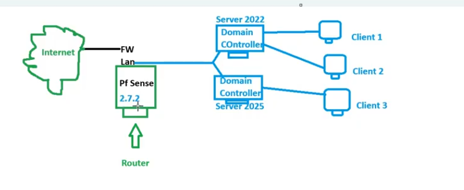

---

## 📋 Lab Inventory

| VM (Hyper-V) | OS | IP | Role |
|---|---|---|---|
| `FW` | pfSense 2.7.2 | WAN DHCP / LAN `10.10.10.254` | Edge firewall, NAT, default gateway |
| `AD-server1 2022` (host `WIN-BU10AOS09CO`) | Windows Server 2022 | `10.10.10.100` | Forest root DC, all 5 FSMO roles (PDC Emulator), DNS, DHCP |
| `AD-server2 2025` (host `AD-SERVER2`) | Windows Server 2025 | `10.10.10.101` | Additional DC, DNS, DHCP failover partner, Print Server, AD CS Enterprise Root CA, IIS |
| `AD-server3 2025` (host `AD-server3`) | Windows Server 2025 | `10.10.10.102` | Additional DC, DNS, Global Catalog (promoted remotely with PowerShell), Microsoft Entra Connect Sync |
| `AD-client1` | Windows client | DHCP | Domain workstation |
| `AD-client2` | Windows client | DHCP | Domain workstation |
| `AD2-client2` | Windows 11 | DHCP | Domain workstation |


---

## 🚀 Build Process

### 1. Network & Firewall (pfSense)

- Deployed **pfSense 2.7.2** as a VM to act as the lab's edge router and firewall.
- **WAN (`hn0`)** connected to an **External Virtual Switch** bound to the host's Wi-Fi adapter — receives an address from the home router via DHCP.
- **LAN (`hn1`)** connected to a **Private Virtual Switch** (`Lab-LAN`) with static address `10.10.10.254/24` — the default gateway for every lab machine.
- Result: the entire domain sits on an isolated network behind pfSense NAT; nothing in the lab is exposed to the home network, while machines still have internet access for updates.

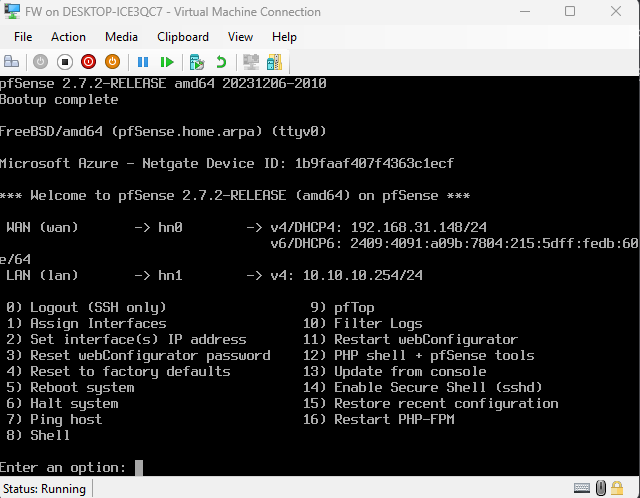

### 2. Active Directory Forest & Domain Controllers

- Installed the **AD DS** role and promoted the first server to a domain controller, creating the new forest **`adlab.local`**.
- Forest and domain functional level: **Windows Server 2016**.
- Enabled **DNS Server** and **Global Catalog** on the DC; set the **Directory Services Restore Mode (DSRM)** password for disaster recovery.
- Promoted a second server (**Windows Server 2025**) as an **additional domain controller**, giving the domain redundancy and **multi-master AD replication** between the two DCs.

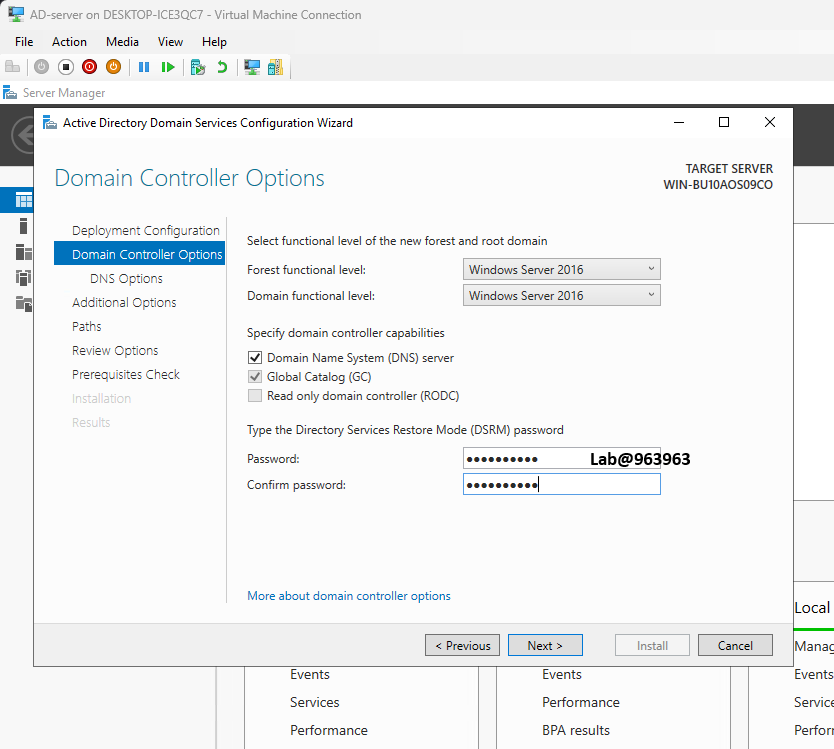

### 3. DHCP, DNS & Failover

- Moved DHCP off pfSense and onto the domain controllers so Windows DHCP and AD-integrated DNS work together (dynamic DNS registration of clients).
- Created the IPv4 scope for `10.10.10.0/24` with options for **router (003 → 10.10.10.254)** and **DNS servers (006 → domain controllers)**.
- Built **DNS Reverse Lookup Zones** so PTR records resolve IP → hostname, required for clean name resolution and troubleshooting.
- Configured **DHCP Failover** between the two DCs:
  - Mode: **Load balance – 50% / 50%**
  - Maximum Client Lead Time: **1 hour**
  - **Message authentication** enabled with a shared secret
  - Partner: `ad-server2.adlab.local`

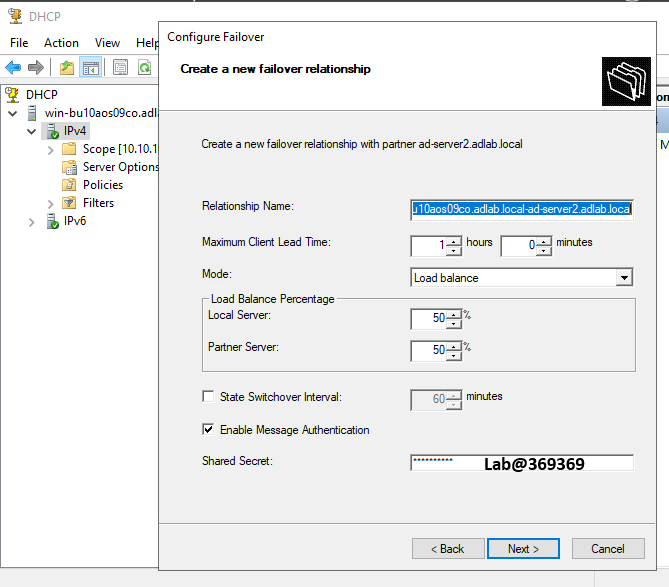

### 4. OU Design & Group Policy

Organizational Units were designed by **geography → object type → department**, so Group Policy can be targeted precisely:

```text
adlab.local
├── Domain Controllers
├── Asia
├── Europe
├── LAB1
└── USA
    ├── Computers
    ├── Servers
    ├── Service Accounts
    └── Users
        ├── Accounting      ← shared_2025_printer_USB
        ├── HR
        └── IT
```

Group Policy Objects created and linked in the lab:

| GPO | Purpose |
|---|---|
| Default Domain Policy | Domain-wide baseline |
| Password Policy | Password length / complexity / age |
| Account Lockout Policy | Lock accounts after failed logons |
| Disable USB devices | Block removable storage |
| Desktop Wallpaper | Standard corporate wallpaper |
| Drive Mapping / Mapped Drives | Map network shares for users |
| User Rights | User rights assignment |
| shared_2025_printer_USB | Deploy the shared printer to the Accounting OU |

### 5. Print Server & GPO Printer Deployment

Configured `AD-server2` (Windows Server 2025) as a **print server** and delivered printers to users with **Group Policy Preferences**:

- **Two connection methods** for the same EPSON L130 printer:
  - **USB-attached** queue (host USB printer redirected into the server, port `TS006`)
  - **IP-based** queue on a **Standard TCP/IP port** (`10.10.10.103`, RAW 9100)
- **x64 + x86 drivers** (v2.60.0.0) loaded so both 64-bit and 32-bit clients get the correct driver automatically.
- Printers **shared** and **listed in Active Directory**; client-side rendering enabled.
- GPO **`shared_2025_printer_USB`** (User Config → Preferences → Printers → *Create*) linked to the **Accounting OU** — Accounting users receive the printer automatically at logon.
- Verified from clients: **automatic GPO delivery** and **manual connection via `\\10.10.10.101`**, with print jobs reaching the server queue.

➡️ **Full step-by-step walkthrough with 26 screenshots: [docs/print-server-deployment.md](docs/print-server-deployment.md)**

| | |
|---|---|
|  |  |

### 6. PowerShell Automation for AD

Automated the everyday user-lifecycle tasks with the **ActiveDirectory PowerShell module** in PowerShell ISE, and verified every change in ADUC:

- **Create users** — interactively (`Read-Host -AsSecureString`) and **in bulk from CSV** (`Import-Csv | New-ADUser`), with a `FirstName + LastInitial` naming convention and UPN `user@adlab.local`.
- **Passwords** — single reset with *change password at next logon*; **bulk reset + unlock** from CSV.
- **OU management** — moved users from `Temp Users` to `USA › Users` with `Move-ADObject`.
- **Groups** — added/removed members of `Account_User` with `Add-ADGroupMember` / `Remove-ADGroupMember`.
- **Security hygiene** — disabled inactive accounts based on `LastLogonDate`, checked with an ADUC saved query.
- **Reporting** — exported OU and domain-wide user reports to CSV.
- Diagnosed a real AD error: **duplicate UPN** when two users produced the same logon name.

➡️ **Walkthrough with 12 screenshots: [docs/powershell-ad-automation.md](docs/powershell-ad-automation.md)** · **Scripts: [scripts/](scripts/)**

| | |
|---|---|
| 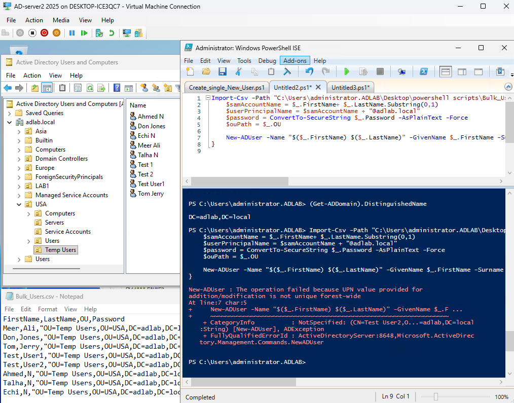 | 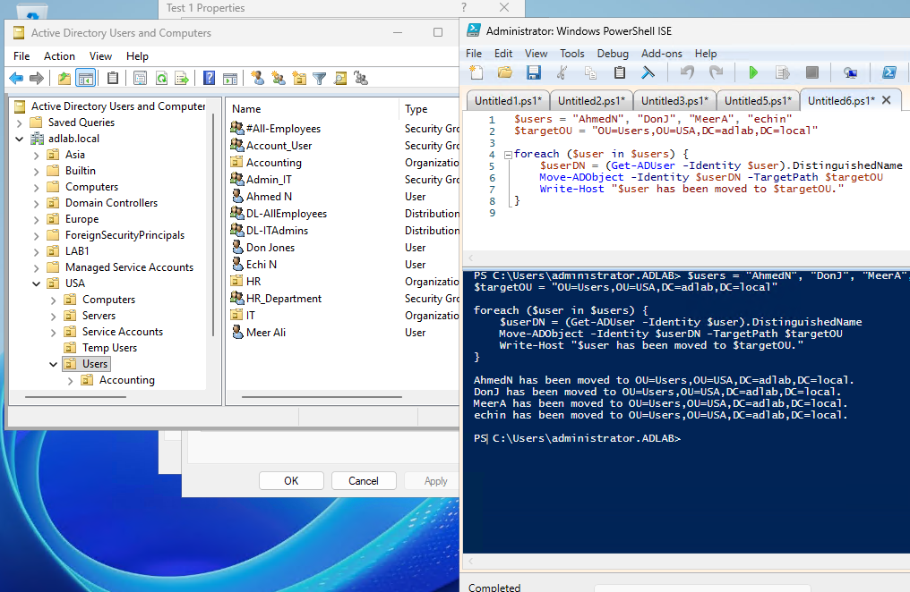 |

### 7. Local Admin Rights for IT Helpdesk via GPO

Delegated **local administrator rights on end-user PCs** to the IT helpdesk without making them Domain Admins:

- GPO **`End User PC Local Admin`** linked to the **`USA`** OU.
- *Computer Configuration › Preferences › Local Users and Groups* → **Administrators (built-in)**, action **Update**, member **`ADLAB\Admin_IT`** added.
- **Update** keeps the existing members (`Administrator`, `Domain Admins`) and adds the helpdesk group.
- Verified on `AD2-client2`: `ADLAB\Admin_IT` appears in the local Administrators group after the policy applied. A standard Accounting user is still blocked by restrictions.

➡️ **Walkthrough with screenshots: [docs/gpo-local-admin-rights.md](docs/gpo-local-admin-rights.md)**

| | |
|---|---|
| 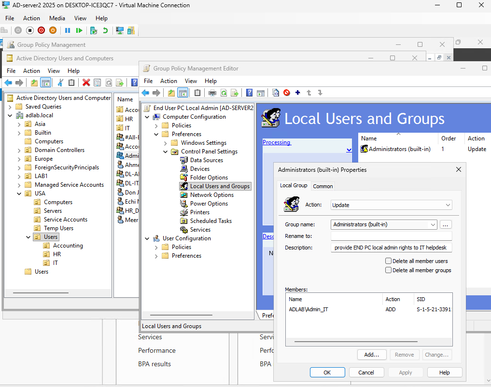 |  |

### 8. Troubleshooting AD Replication (DNS + Kerberos)

After the forest root DC had been powered off for about 20 days, replication between the two DCs was broken (**5/5 failures, 20-day delta**). I diagnosed and fixed it step by step:

- **Error 8524 (DNS lookup failure)**: the partner DC was offline. Brought it back and verified both DCs with `nslookup`.
- **"The target principal name is incorrect" (0x80090322 / `KRB_AP_ERR_MODIFIED`)**: the DC machine account passwords were out of sync. Reset them with `netdom resetpwd` (KDC stopped) and purged SYSTEM Kerberos tickets with `klist -li 0x3e7 purge`.
- **Time source**: moved the DCs from Hyper-V time sync to the AD time hierarchy (`w32tm /syncfromflags:domhier`).
- **Verified**: `repadmin /syncall /AdeP` ran with no errors, and `repadmin /replsummary` showed **0/5 failures** in both directions.

➡️ **Full troubleshooting walkthrough: [docs/ad-replication-kerberos-repair.md](docs/ad-replication-kerberos-repair.md)**

| | |
|---|---|
| 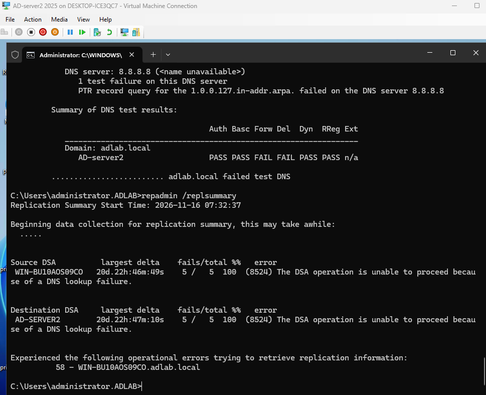 |  |
| *Before: 100% failures, 20-day delta* | *After: 0 failures* |

### 9. Internal HTTPS with AD CS & IIS

Published an internal **print server status page** at `https://printserver.adlab.local`, secured with a certificate from the domain's own CA:

- Installed **AD CS (Enterprise Root CA)**, because public CAs cannot issue certificates for `.local` names.
- Created a CSR in IIS and submitted it through **`/certsrv`** Web Enrollment using the **Web Server** template. Along the way I resolved an HTTP 403.4 (SSL required), a certificate name mismatch, and a duplicate 443 binding.
- Added a DNS **A record** `printserver → 10.10.10.101` and deployed an HTML/JS page that checks printer `10.10.10.103`.
- Added an HTTPS binding with **SNI**, and noted that browsers require a **SAN** in the certificate (`certreq` with an `.inf` file).

➡️ **Walkthrough: [docs/adcs-iis-https-print-portal.md](docs/adcs-iis-https-print-portal.md)**

### 10. Transferring FSMO Roles

Moved all five **FSMO roles** between the domain controllers and back, using both methods:

- **PowerShell**: `Move-ADDirectoryServerOperationMasterRole -Identity "ad-server2" -OperationMasterRole 0,1,2,3,4` moved all five roles to AD-SERVER2 in one command.
- **GUI**: moved them back to WIN-BU10AOS09CO role by role:
  - **Schema Master** in the AD Schema snap-in (`regsvr32 schmmgmt.dll`)
  - **Domain Naming Master** in AD Domains and Trusts
  - **RID, PDC and Infrastructure** in ADUC
  - Before each transfer, the console was pointed at the target DC with *Change Directory Server*.
- Verified each stage with `netdom query fsmo`.

➡️ **Walkthrough with 11 screenshots: [docs/fsmo-role-transfer.md](docs/fsmo-role-transfer.md)**

| | |
|---|---|
| 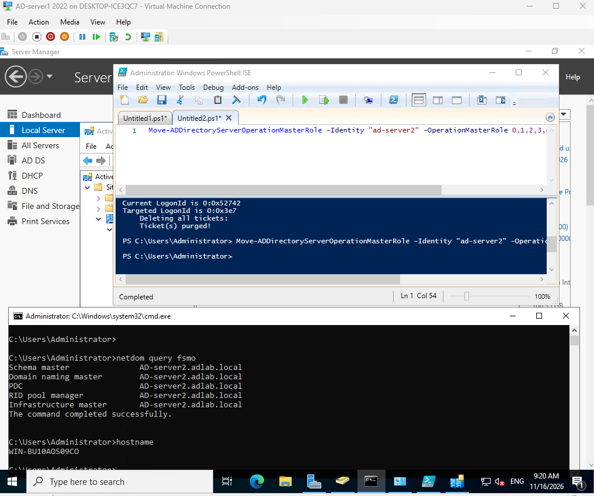 | 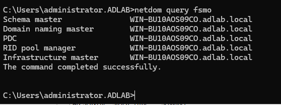 |

### 11. Remote DC Promotion with PowerShell

Built a **third domain controller (AD-server3, Windows Server 2025)** entirely from AD-server1 over **PowerShell Remoting**:

- Static IP `10.10.10.102`, with DNS pointing at the existing DCs (`.101` and `.100`).
- `Enter-PSSession` to the new server. Fixed the **WinRM TrustedHosts** error you get when connecting to a non-domain machine by IP.
- Installed AD DS remotely with `Install-WindowsFeature`.
- Promoted it with the **`Install-ADDSDomainController` script exported from the wizard's *View script***: Global Catalog, DNS, `Default-First-Site-Name`.
- Verified that AD-server3 is a member of `adlab.local` running AD DS and DNS.

➡️ **Walkthrough with screenshots: [docs/remote-dc-promotion-powershell.md](docs/remote-dc-promotion-powershell.md)**

| | |
|---|---|
| 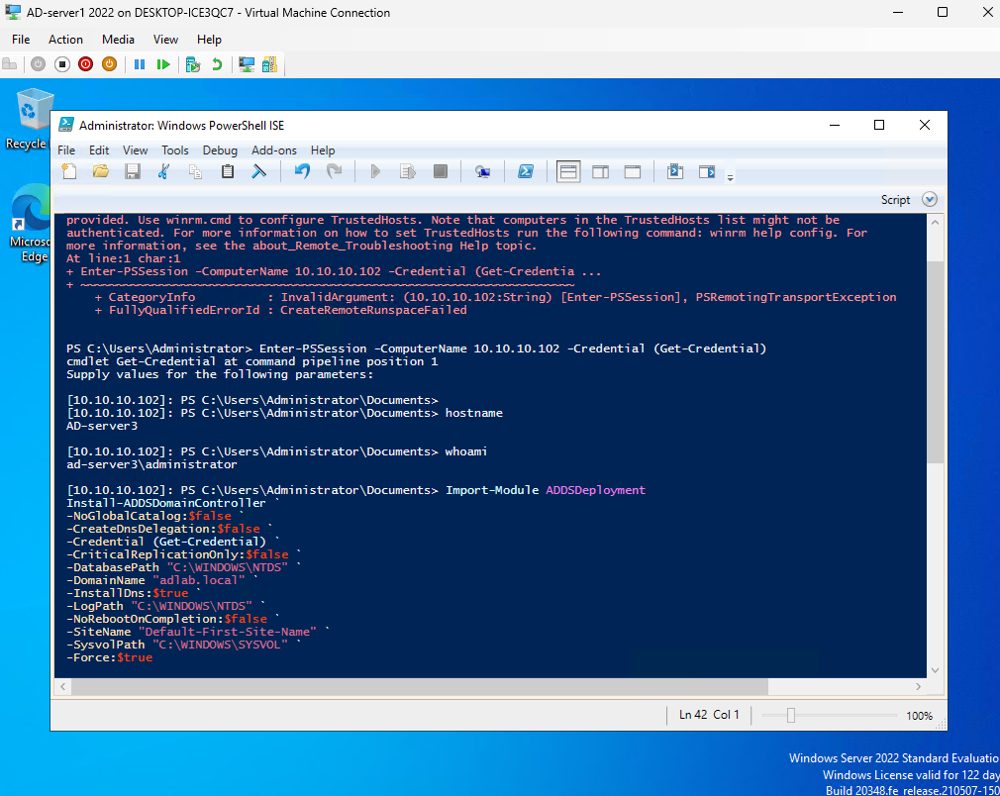 | 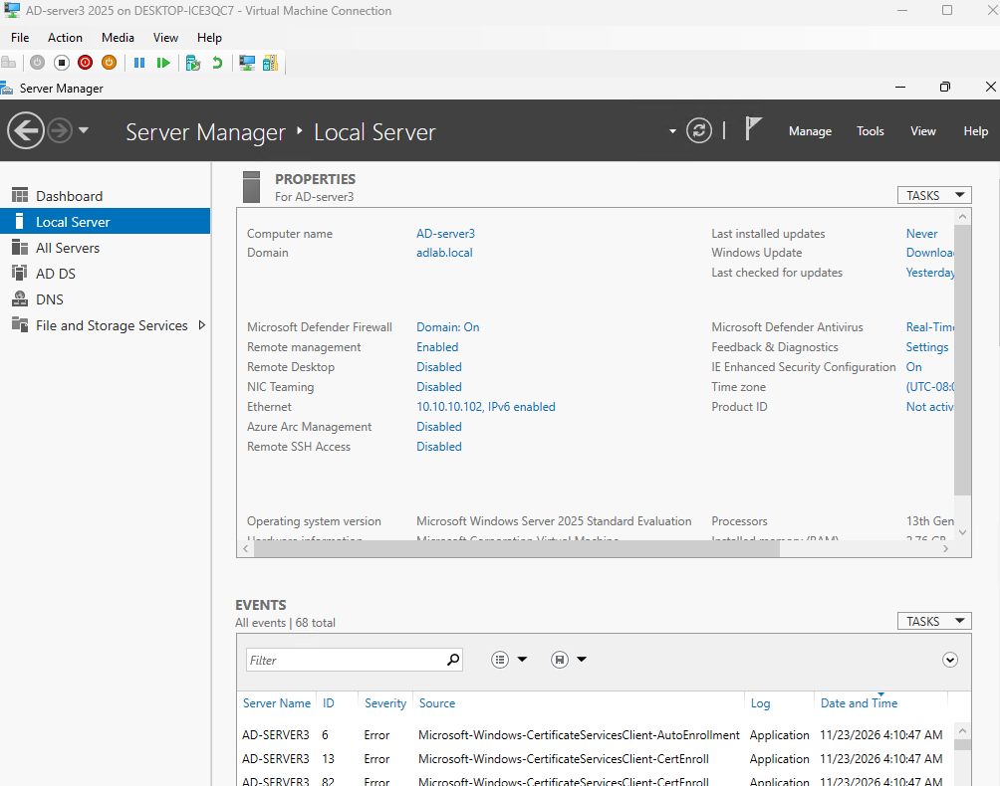 |

### 12. Hybrid Identity with Microsoft Entra Connect Sync

Connected the on-premises domain to **Microsoft Entra ID** (formerly Azure AD), so AD users and groups sync to the cloud automatically:

- **Tenant setup**: created a **Global Administrator** and a separate least-privilege **Hybrid Identity Administrator** (`syncadmin`) to run the sync setup.
- **UPN preparation**: added the tenant's `onmicrosoft.com` domain as an **alternative UPN suffix** in AD, because `adlab.local` cannot be verified in the cloud.
- **Entra Connect Sync** on AD-server3: **Password Hash Synchronization**, a wizard-created AD connector account, source anchor **mS-DS-ConsistencyGuid**, syncing all users and devices.
- **Verified**: 17 users synced on the first run. New AD users Test 2 and Test 4 appeared after the next cycle (19 users). Observed how an unverified `@adlab.local` UPN is replaced with the `onmicrosoft.com` domain in the cloud.
- **Microsoft Entra ID P1 licensing**: direct assignment, plus **group-based licensing** through the on-premises `Admin_IT` group synced to the cloud.

➡️ **Walkthrough with 20 screenshots: [docs/entra-connect-hybrid-identity.md](docs/entra-connect-hybrid-identity.md)**

| | |
|---|---|
|  |  |

---

## 💡 Skills Demonstrated

| Area | Skills |
|---|---|
| **Virtualization** | Hyper-V Gen 2 VMs, External vs Private virtual switches, checkpoints, Enhanced Session |
| **Networking** | pfSense WAN/LAN design, NAT, subnetting, default gateway, network isolation |
| **Active Directory** | Forest/domain creation, functional levels, additional DC promotion, replication, Global Catalog, DSRM, FSMO role transfer (PowerShell & GUI) |
| **DNS** | AD-integrated zones, reverse lookup zones / PTR records |
| **DHCP** | Scopes, scope options (003/006), DHCP failover in load-balance mode with authentication |
| **Group Policy** | OU design, GPO creation/linking, security & user-environment policies, Group Policy Preferences (printers, local groups), delegating local admin rights |
| **PowerShell** | ActiveDirectory module, CSV-driven bulk operations, pipelines, SecureString handling, reporting with Export-Csv, PowerShell Remoting (WinRM, TrustedHosts), Install-ADDSDomainController |
| **Print Services** | Print Management, TCP/IP ports, multi-architecture drivers, AD-published printers, GPO printer deployment |
| **PKI & Web** | AD CS Enterprise CA, CSRs, Web Enrollment, certificate templates, IIS HTTPS bindings, SNI, SAN |
| **Cloud / Hybrid Identity** | Microsoft Entra ID, Entra Connect Sync, Password Hash Sync, UPN suffixes, source anchor, Entra admin roles, Entra ID P1 group-based licensing, Microsoft 365 admin center |
| **Troubleshooting** | Client ↔ server validation, UNC connectivity, following print jobs through the spooler, AD replication (repadmin, dcdiag), Kerberos (KRB_AP_ERR_MODIFIED), netdom resetpwd, w32tm |

---

## 📂 Repository Structure

```text
.
├── README.md                          ← this overview
├── docs/
│   ├── print-server-deployment.md     ← print server lab walkthrough
│   ├── powershell-ad-automation.md    ← PowerShell AD automation walkthrough
│   ├── gpo-local-admin-rights.md      ← local admin delegation via GPO
│   ├── ad-replication-kerberos-repair.md ← replication / Kerberos troubleshooting
│   ├── adcs-iis-https-print-portal.md ← AD CS + IIS HTTPS site
│   ├── fsmo-role-transfer.md          ← FSMO role transfer
│   ├── remote-dc-promotion-powershell.md ← third DC promoted over PowerShell Remoting
│   └── entra-connect-hybrid-identity.md ← AD → Microsoft Entra ID sync
├── scripts/                           ← 10 PowerShell scripts + sample CSVs
└── images/
    ├── infrastructure/                ← Hyper-V, pfSense, AD DS, DHCP screenshots
    ├── print-server/                  ← 26 print server / GPO screenshots (in order)
    ├── powershell/                    ← 12 PowerShell lab screenshots (in order)
    ├── local-admin-gpo/               ← 7 local admin GPO screenshots (in order)
    ├── replication-repair/            ← 5 replication troubleshooting screenshots (in order)
    ├── fsmo-transfer/                 ← 11 FSMO transfer screenshots (in order)
    ├── remote-dc-promotion/           ← 5 remote DC promotion screenshots (in order)
    └── entra-connect/                 ← 20 Entra Connect screenshots (in order)
```

---

*This lab is a personal learning environment. All names, addresses and credentials are lab-only and not used in any production system.*
