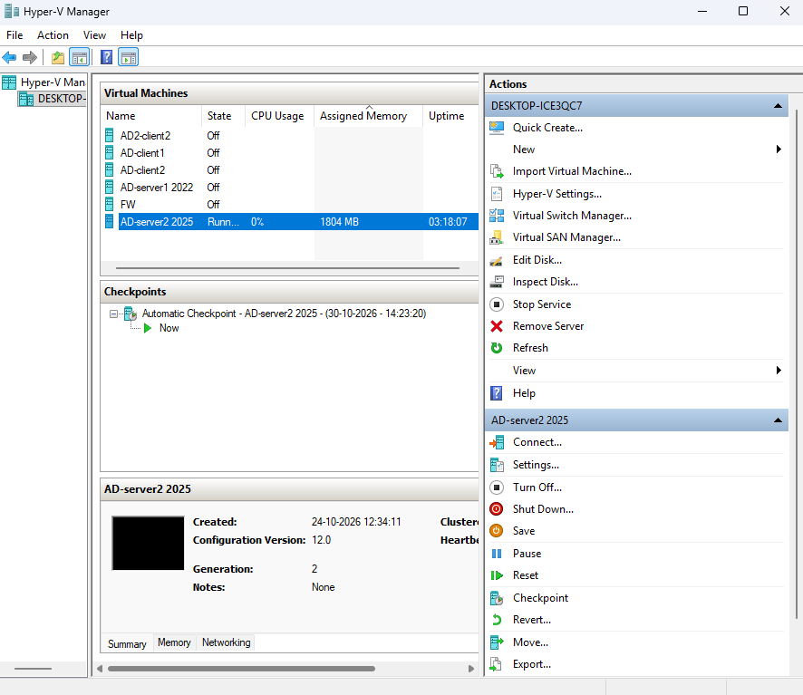
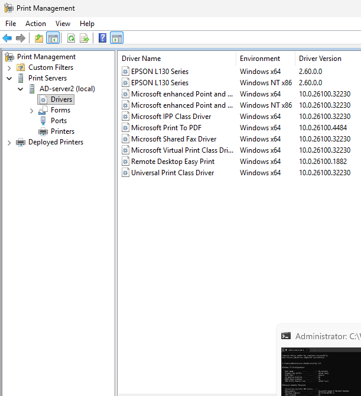
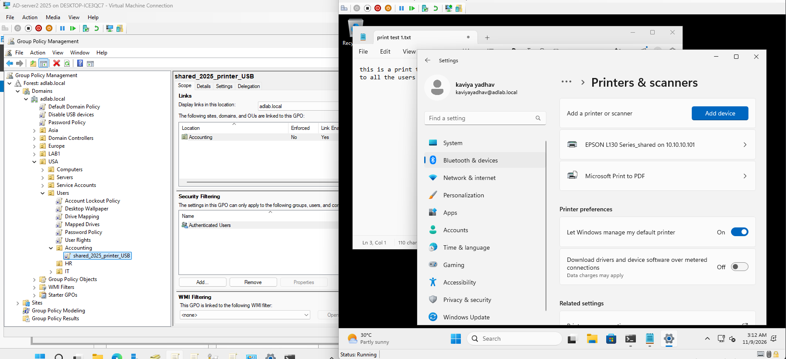

# Enterprise Active Directory Home Lab on Hyper-V

A self-built, isolated corporate network running on a single Hyper-V host — used to practice the day-to-day work of a **Windows System Administrator**: Active Directory, DNS, DHCP, Group Policy, replication and print services.


---

## 📑 Contents

- [Lab Overview](#-lab-overview)
- [Architecture](#%EF%B8%8F-architecture)
- [Lab Inventory](#-lab-inventory)
- [Build Process](#-build-process)
  - [1. Network & Firewall](#1-network--firewall-pfsense)
  - [2. Active Directory Forest & Domain Controllers](#2-active-directory-forest--domain-controllers)
  - [3. DHCP, DNS & Failover](#3-dhcp-dns--failover)
  - [4. OU Design & Group Policy](#4-ou-design--group-policy)
  - [5. Print Server & GPO Printer Deployment](#5-print-server--gpo-printer-deployment)
- [Skills Demonstrated](#-skills-demonstrated)
- [Repository Structure](#-repository-structure)

---

## 📌 Lab Overview

| | |
|---|---|
| **Hypervisor** | Microsoft Hyper-V (Generation 2 VMs) |
| **Firewall / Router** | pfSense 2.7.2 |
| **Domain** | `adlab.local` (Forest & Domain functional level: Windows Server 2016) |
| **Domain Controllers** | Windows Server 2022 + Windows Server 2025 (multi-DC, replicated) |
| **Core Services** | AD DS, DNS (forward & reverse zones), DHCP with failover, Print and Document Services |
| **Clients** | Windows 10/11 Enterprise, domain-joined |
| **Management** | Server Manager, ADUC, GPMC, DHCP console, Print Management, PowerShell |

---

## 🏗️ Architecture

```text
               Internet
                  │
       [ Home Wi-Fi router ]  192.168.31.0/24
                  │
   Hyper-V External Virtual Switch (bound to host Wi-Fi adapter)
                  │
     ┌────────────┴────────────┐
     │  pfSense 2.7.2  (FW)    │  WAN  hn0 : 192.168.31.148/24 (DHCP)
     │                         │  LAN  hn1 : 10.10.10.254/24  ← lab gateway
     └────────────┬────────────┘
                  │  Hyper-V Private Switch "Lab-LAN"  10.10.10.0/24
        ┌─────────┴──────────────────────────┐
        │                                    │
 ┌──────┴──────────────────┐     ┌───────────┴──────────────────┐
 │ AD-server1 · Server 2022│◄───►│ AD-server2 · Server 2025     │
 │ 10.10.10.100            │ AD  │ 10.10.10.101                 │
 │ AD DS · DNS · DHCP      │ rep │ AD DS · DNS · DHCP (failover)│
 │ Forest root DC          │     │ Print Server                 │
 └──────────┬──────────────┘     └───────────┬──────────────────┘
            └───────────────┬────────────────┘
                            │
          ┌─────────────────┼─────────────────┐
     AD-client1        AD-client2        AD2-client2
                (domain-joined, DHCP-addressed)
```


---

## 📋 Lab Inventory

| VM (Hyper-V) | OS | IP | Role |
|---|---|---|---|
| `FW` | pfSense 2.7.2 | WAN DHCP / LAN `10.10.10.254` | Edge firewall, NAT, default gateway |
| `AD-server1 2022` | Windows Server 2022 | `10.10.10.100` | Forest root DC, DNS, DHCP |
| `AD-server2 2025` | Windows Server 2025 | `10.10.10.101` | Additional DC, DNS, DHCP failover partner, Print Server |
| `AD-client1` | Windows client | DHCP | Domain workstation |
| `AD-client2` | Windows client | DHCP | Domain workstation |
| `AD2-client2` | Windows 11 | DHCP | Domain workstation |



---

## 🚀 Build Process

### 1. Network & Firewall (pfSense)

- Deployed **pfSense 2.7.2** as a VM to act as the lab's edge router and firewall.
- **WAN (`hn0`)** connected to an **External Virtual Switch** bound to the host's Wi-Fi adapter — receives an address from the home router via DHCP.
- **LAN (`hn1`)** connected to a **Private Virtual Switch** (`Lab-LAN`) with static address `10.10.10.254/24` — the default gateway for every lab machine.
- Result: the entire domain sits on an isolated network behind pfSense NAT; nothing in the lab is exposed to the home network, while machines still have internet access for updates.


### 2. Active Directory Forest & Domain Controllers

- Installed the **AD DS** role and promoted the first server to a domain controller, creating the new forest **`adlab.local`**.
- Forest and domain functional level: **Windows Server 2016**.
- Enabled **DNS Server** and **Global Catalog** on the DC; set the **Directory Services Restore Mode (DSRM)** password for disaster recovery.
- Promoted a second server (**Windows Server 2025**) as an **additional domain controller**, giving the domain redundancy and **multi-master AD replication** between the two DCs.


### 3. DHCP, DNS & Failover

- Moved DHCP off pfSense and onto the domain controllers so Windows DHCP and AD-integrated DNS work together (dynamic DNS registration of clients).
- Created the IPv4 scope for `10.10.10.0/24` with options for **router (003 → 10.10.10.254)** and **DNS servers (006 → domain controllers)**.
- Built **DNS Reverse Lookup Zones** so PTR records resolve IP → hostname, required for clean name resolution and troubleshooting.
- Configured **DHCP Failover** between the two DCs:
  - Mode: **Load balance – 50% / 50%**
  - Maximum Client Lead Time: **1 hour**
  - **Message authentication** enabled with a shared secret
  - Partner: `ad-server2.adlab.local`


### 4. OU Design & Group Policy

Organizational Units were designed by **geography → object type → department**, so Group Policy can be targeted precisely:

```text
adlab.local
├── Domain Controllers
├── Asia
├── Europe
├── LAB1
└── USA
    ├── Computers
    ├── Servers
    ├── Service Accounts
    └── Users
        ├── Accounting      ← shared_2025_printer_USB
        ├── HR
        └── IT
```

Group Policy Objects created and linked in the lab:

| GPO | Purpose |
|---|---|
| Default Domain Policy | Domain-wide baseline |
| Password Policy | Password length / complexity / age |
| Account Lockout Policy | Lock accounts after failed logons |
| Disable USB devices | Block removable storage |
| Desktop Wallpaper | Standard corporate wallpaper |
| Drive Mapping / Mapped Drives | Map network shares for users |
| User Rights | User rights assignment |
| shared_2025_printer_USB | Deploy the shared printer to the Accounting OU |

### 5. Print Server & GPO Printer Deployment

Configured `AD-server2` (Windows Server 2025) as a **print server** and delivered printers to users with **Group Policy Preferences**:

- **Two connection methods** for the same EPSON L130 printer:
  - **USB-attached** queue (host USB printer redirected into the server, port `TS006`)
  - **IP-based** queue on a **Standard TCP/IP port** (`10.10.10.103`, RAW 9100)
- **x64 + x86 drivers** (v2.60.0.0) loaded so both 64-bit and 32-bit clients get the correct driver automatically.
- Printers **shared** and **listed in Active Directory**; client-side rendering enabled.
- GPO **`shared_2025_printer_USB`** (User Config → Preferences → Printers → *Create*) linked to the **Accounting OU** — Accounting users receive the printer automatically at logon.
- Verified from clients: **automatic GPO delivery** and **manual connection via `\\10.10.10.101`**, with print jobs reaching the server queue.

➡️ **Full step-by-step walkthrough with 26 screenshots: [docs/print-server-deployment.md](docs/print-server-deployment.md)**

| | |
|---|---|
|  |  |

---

## 💡 Skills Demonstrated

| Area | Skills |
|---|---|
| **Virtualization** | Hyper-V Gen 2 VMs, External vs Private virtual switches, checkpoints, Enhanced Session |
| **Networking** | pfSense WAN/LAN design, NAT, subnetting, default gateway, network isolation |
| **Active Directory** | Forest/domain creation, functional levels, additional DC promotion, replication, Global Catalog, DSRM |
| **DNS** | AD-integrated zones, reverse lookup zones / PTR records |
| **DHCP** | Scopes, scope options (003/006), DHCP failover in load-balance mode with authentication |
| **Group Policy** | OU design, GPO creation/linking, security & user-environment policies, Group Policy Preferences |
| **Print Services** | Print Management, TCP/IP ports, multi-architecture drivers, AD-published printers, GPO printer deployment |
| **Troubleshooting** | Client ↔ server validation, UNC connectivity, following print jobs through the spooler |

---

## 📂 Repository Structure

```text
.
├── README.md                          ← this overview
├── docs/
│   └── print-server-deployment.md     ← print server lab walkthrough
├── images/
│   ├── infrastructure/                ← Hyper-V, pfSense, AD DS, DHCP screenshots
│   └── print-server/                  ← 26 print server / GPO screenshots (in order)
└── scripts.ps1
```

---

*This lab is a personal learning environment. All names, addresses and credentials are lab-only and not used in any production system.*
