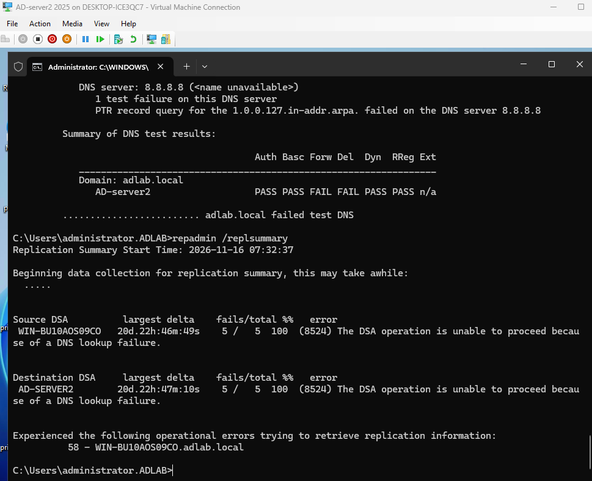
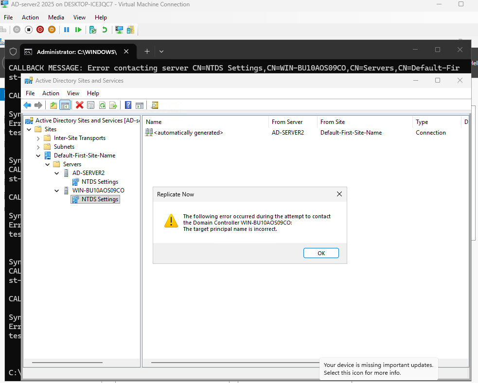
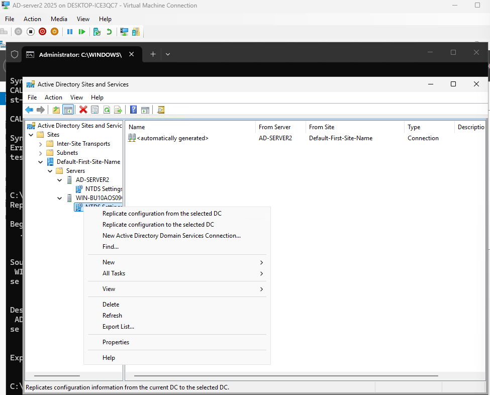
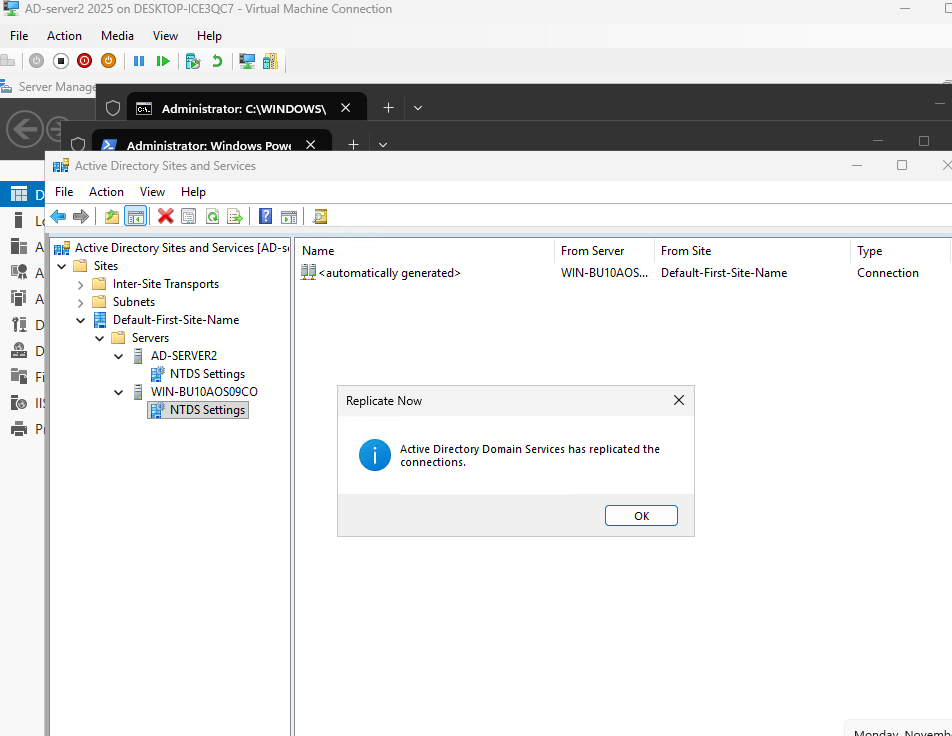
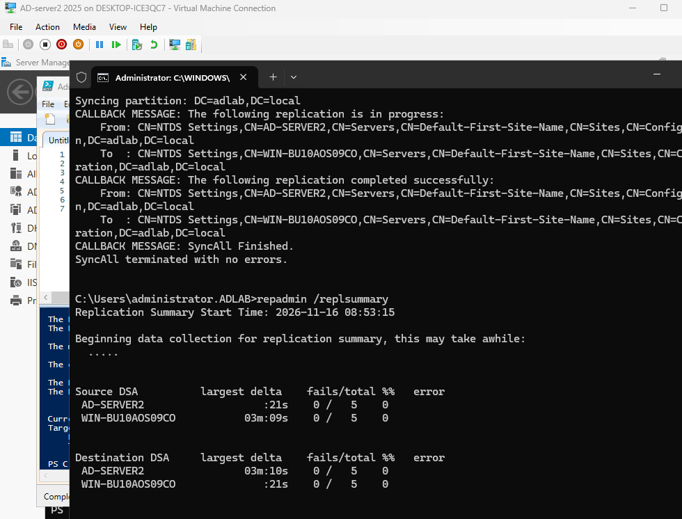

# Troubleshooting & Repairing AD Replication (DNS + Kerberos)

**Lab date:** 16 November 2026  
**Domain:** `adlab.local` (forest/domain functional level: Windows Server 2016)  
**Domain Controllers:**

| DC | OS | IP | Notes |
|---|---|---|---|
| `WIN-BU10AOS09CO.adlab.local` | Windows Server 2022 | `10.10.10.100` | Forest root DC, holds **all 5 FSMO roles** (incl. PDC Emulator), had been powered off for ~20 days |
| `AD-SERVER2.adlab.local` | Windows Server 2025 | `10.10.10.101` | Additional DC, DNS, AD CS, IIS. Kept running alone during that time |

[← Back to main README](../README.md)

---

## 🧩 Scenario

The forest root DC (`WIN-BU10AOS09CO`) was **powered off for about 20 days** while `AD-SERVER2` kept running. When it was brought back, the two DCs could no longer replicate. The goal was to find the root cause using the standard AD diagnostic tools, repair replication, and prove the domain was healthy again.

```text
07:32  repadmin: 5/5 failures, delta 20d 22h, error 8524 (DNS lookup failure)
  │      → partner DC offline / name not resolvable
  ▼
       Partner DC online, nslookup OK for both DCs
  │
  ▼
       Replicate Now: "The target principal name is incorrect" (0x80090322)
  │      → Kerberos KRB_AP_ERR_MODIFIED: DC machine account passwords out of sync
  ▼
       Fix time hierarchy  →  netdom resetpwd (KDC stopped)  →  klist purge
  │
  ▼
08:53  repadmin /syncall: no errors; /replsummary: 0/5 failures, largest delta 21s ✔
```

---

## 🔍 Step 1 — Audit the domain and find the failure

Baseline checks:

| Command | Finding |
|---|---|
| `netdom query fsmo` | `WIN-BU10AOS09CO` holds Schema Master, Domain Naming Master, PDC Emulator, RID Master and Infrastructure Master |
| `net share` | `SYSVOL` and `NETLOGON` shared on the DC |
| `dcdiag`, `dcdiag /q` | DNS test failed on `AD-server2` |
| `repadmin /showrepl`, `repadmin /replsummary` | Replication failing in both directions |

`repadmin /replsummary` at **07:32** showed:

- **5 / 5 failures (100%)** in both directions
- **Largest delta: 20 days 22 hours**, so the DCs had not replicated for about 3 weeks
- **Error 8524**: *"The DSA operation is unable to proceed because of a DNS lookup failure"*
- Operational error **58** retrieving replication information from `WIN-BU10AOS09CO.adlab.local`

The `dcdiag` DNS summary for `AD-server2` showed **Forwarders: FAIL** (forwarder `8.8.8.8`) and **Delegation: FAIL**. A delegation failure is expected for a `.local` domain with no parent zone.



## 🔍 Step 2 — First error: DNS lookup failure (8524)

Error 8524 means a DC cannot resolve its replication partner. At that point `WIN-BU10AOS09CO` was still offline, so its records could not be resolved or reached.

**Action:** Brought `WIN-BU10AOS09CO` back online and verified name resolution from both DCs:

```cmd
nslookup WIN-BU10AOS09CO.adlab.local   → 10.10.10.100
nslookup AD-SERVER2.adlab.local        → 10.10.10.101
```

DNS resolved cleanly, so the 8524 error was cleared and the next problem appeared.

## 🔍 Step 3 — Second error: "The target principal name is incorrect"

Forcing replication in **Active Directory Sites and Services** (*NTDS Settings › connection › Replicate Now*) failed with:

> The following error occurred during the attempt to contact the Domain Controller WIN-BU10AOS09CO: **The target principal name is incorrect.**

This is error **`-2146893022` (0x80090322)**. The System event log recorded **Kerberos Event ID 4 — `KRB_AP_ERR_MODIFIED`**.



## 🧠 Step 4 — Root cause analysis

**Root cause: DC machine account passwords out of sync**

- Every DC has a computer account (`WIN-BU10AOS09CO$`, `AD-SERVER2$`) whose password is changed automatically about every **30 days**.
- While `WIN-BU10AOS09CO` was offline, `AD-SERVER2` changed its machine password. The new password existed only in `AD-SERVER2`'s copy of the directory, because replication was not happening.
- `WIN-BU10AOS09CO` still held the **old** password. Kerberos tickets it issued for `AD-SERVER2` were encrypted with the old key, so `AD-SERVER2` could not decrypt them, which produced **`KRB_AP_ERR_MODIFIED`**.
- Reverting a DC to an old **Hyper-V checkpoint** causes the same symptom, so automatic checkpoints should be disabled on DC VMs.

**Also found and fixed: wrong time source**

- `w32tm /query /source` showed both DCs taking time from Hyper-V (**VM IC Time Synchronization Provider**) instead of the AD time hierarchy.
- Time skew produces a *different* Kerberos error (`KRB_AP_ERR_SKEW`, when clocks differ by more than 5 minutes), so it was **not** the cause of this failure. A correct time hierarchy is still a requirement for healthy Kerberos, so it was fixed at the same time.

---

## 🛠️ Step 5 — Fix the time hierarchy

Disabled **Hyper-V Integration Services › Time Synchronization** for the DC VMs, then set `AD-SERVER2` to follow the domain hierarchy, with the PDC Emulator as its source:

```cmd
w32tm /config /syncfromflags:domhier /update
net stop w32time && net start w32time
w32tm /resync /force
w32tm /query /source
```

> The **PDC Emulator** (`WIN-BU10AOS09CO`) is the top of the domain time hierarchy and should take time from a reliable external source:
> `w32tm /config /manualpeerlist:"pool.ntp.org" /syncfromflags:manual /reliable:yes /update`

## 🛠️ Step 6 — Reset the DC machine account passwords

Microsoft's documented procedure for `KRB_AP_ERR_MODIFIED` between DCs, run **on the DC whose password needs resetting**, pointing at its partner DC:

```cmd
net stop kdc
netdom resetpwd /server:<PartnerDC>.adlab.local /userd:ADLAB\Administrator /passwordd:*
net start kdc
klist -li 0x3e7 purge
```

| Command | Why |
|---|---|
| `net stop kdc` | Stops the local KDC so this DC requests tickets from the partner DC, not from itself with the stale key |
| `netdom resetpwd` | Resets **this** DC's computer account password and writes it to the partner DC |
| `klist -li 0x3e7 purge` | Purges cached Kerberos tickets of the **SYSTEM** account (logon ID `0x3e7`), which replication runs as. This avoids a reboot |

`netdom resetpwd` only resets the password of the machine it runs on. After the first reset, outbound replication from `AD-SERVER2` to `WIN-BU10AOS09CO` was at **0 / 5 failures**. The remaining inbound direction was fixed by running the same reset for `AD-SERVER2$` against `WIN-BU10AOS09CO`.

## 🛠️ Step 7 — Force replication

From **Active Directory Sites and Services** (*NTDS Settings › connection › Replicate Now*):

| | |
|---|---|
|  |  |
| *Replication options on the partner DC's NTDS Settings* | *"Active Directory Domain Services has replicated the connections."* |

Then forced a full sync of every partition from the command line:

```cmd
repadmin /syncall /AdeP
```

`A` = all partitions, `d` = show servers by distinguished name, `e` = enterprise (across sites), `P` = push changes out from this DC.

## ✅ Step 8 — Verify

At **08:53**, `repadmin /syncall` completed with *"SyncAll terminated with no errors"*, and `repadmin /replsummary` showed:

| Source DSA | Largest delta | Fails / Total |
|---|---|---|
| AD-SERVER2 | 21s | **0 / 5** |
| WIN-BU10AOS09CO | 3m 09s | **0 / 5** |

| Destination DSA | Largest delta | Fails / Total |
|---|---|---|
| AD-SERVER2 | 3m 10s | **0 / 5** |
| WIN-BU10AOS09CO | 21s | **0 / 5** |



Replication went from **about 21 days behind with 100% failures** to **fully healthy in both directions**.

---

## 📋 Command Reference

| Command | Purpose |
|---|---|
| `netdom query fsmo` | Show which DC holds each FSMO role |
| `dcdiag` / `dcdiag /q` | DC health check (`/q` shows errors only) |
| `repadmin /replsummary` | Replication failures and largest delta per DC |
| `repadmin /showrepl` | Per-partition replication status and last error |
| `repadmin /syncall /AdeP` | Force full replication of all partitions |
| `nslookup <dc>.adlab.local` | Confirm DC name resolution |
| `w32tm /query /source` | Show where the server takes its time from |
| `w32tm /config /syncfromflags:domhier /update` | Follow the AD time hierarchy |
| `netdom resetpwd` | Reset a DC's machine account password against a partner DC |
| `klist -li 0x3e7 purge` | Purge the SYSTEM account's Kerberos tickets |

## 🧠 Key Concepts Demonstrated

- **Reading replication errors**: 8524 points to DNS, and 0x80090322 / `KRB_AP_ERR_MODIFIED` points to Kerberos keys. Fixing one problem can reveal the next.
- **DC computer account passwords** and why a DC left offline (or restored from a checkpoint) can stop authenticating to its partner.
- **Kerberos troubleshooting**: KDC, service tickets, the SYSTEM logon session (`0x3e7`), and `KRB_AP_ERR_MODIFIED` vs `KRB_AP_ERR_SKEW`.
- **Windows Time in a domain**: PDC Emulator at the top, other DCs following `domhier`, and why Hyper-V time sync should not drive DC clocks.
- **FSMO roles** and their placement.
- **Verifying with evidence**: before and after `repadmin /replsummary` output instead of assuming the fix worked.
