# Transferring FSMO Roles — PowerShell and GUI

**Lab date:** 16 November 2026  
**Domain:** `adlab.local`

| DC | OS | IP |
|---|---|---|
| `WIN-BU10AOS09CO.adlab.local` (AD-server1) | Windows Server 2022 | `10.10.10.100` |
| `AD-SERVER2.adlab.local` (AD-server2) | Windows Server 2025 | `10.10.10.101` |

[← Back to main README](../README.md)

---

## 🎯 Objective

Practice moving the five **FSMO (Flexible Single Master Operation) roles** between domain controllers, as you would before maintenance or decommissioning a DC:

1. Move **all five roles** from `WIN-BU10AOS09CO` to `AD-SERVER2` in **one PowerShell command**.
2. Move them **back** using the **GUI consoles**, where each role lives in a different MMC snap-in.
3. Verify each stage with `netdom query fsmo`.

| Role | Scope | GUI console | PowerShell value |
|---|---|---|---|
| PDC Emulator | Domain | Active Directory Users and Computers | `0` / `PDCEmulator` |
| RID Master | Domain | Active Directory Users and Computers | `1` / `RIDMaster` |
| Infrastructure Master | Domain | Active Directory Users and Computers | `2` / `InfrastructureMaster` |
| Schema Master | Forest | Active Directory Schema (`schmmgmt.dll`) | `3` / `SchemaMaster` |
| Domain Naming Master | Forest | Active Directory Domains and Trusts | `4` / `DomainNamingMaster` |

```text
 Start                 PowerShell (one command)          GUI (three consoles)              End
 WIN-BU10AOS09CO  ───────────────────────────►  AD-SERVER2  ───────────────────────────►  WIN-BU10AOS09CO
 all 5 roles            Move-ADDirectoryServer-   all 5 roles   Schema · Domain Naming ·     all 5 roles
                        OperationMasterRole 0..4                RID · PDC · Infrastructure
```

---

## 🛠️ Part 1 — Move all roles to AD-SERVER2 with PowerShell

**Starting point:** `netdom query fsmo` showed all five roles on `WIN-BU10AOS09CO`.

On `WIN-BU10AOS09CO`, first purged the SYSTEM account's cached Kerberos tickets (left over from the earlier [replication repair](ad-replication-kerberos-repair.md)), then moved every role in one command:

```powershell
klist -li 0x3e7 purge

Move-ADDirectoryServerOperationMasterRole -Identity "ad-server2" -OperationMasterRole 0,1,2,3,4
```

`0,1,2,3,4` is shorthand for PDCEmulator, RIDMaster, InfrastructureMaster, SchemaMaster and DomainNamingMaster. Without `-Force` this is a graceful **transfer**: both DCs are online and the current holder hands the role over cleanly.

**Result:** `netdom query fsmo` (run on `WIN-BU10AOS09CO`, confirmed with `hostname`) showed all five roles on **`AD-server2.adlab.local`**.

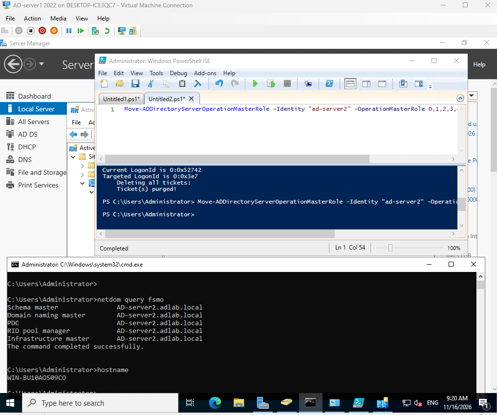

The same check from `AD-SERVER2` shows the before (all on `WIN-BU10AOS09CO`) and after (all on `AD-server2`) states:

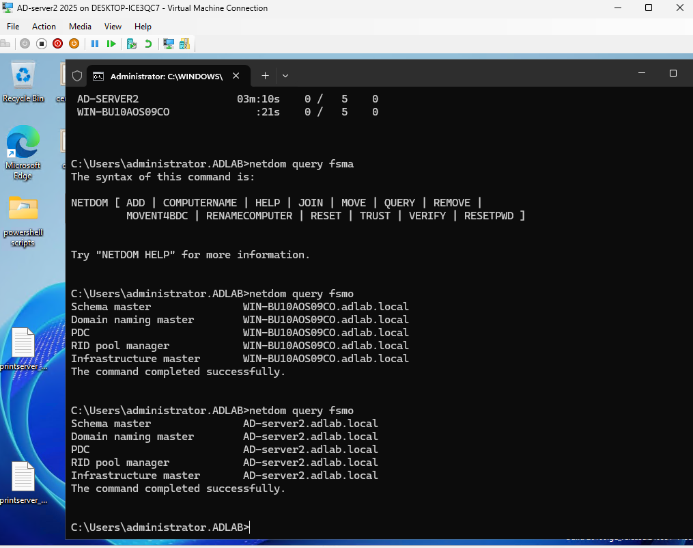

---

## 🛠️ Part 2 — Move the roles back with the GUI

> **Key rule:** in the GUI, a role is transferred **to the DC the console is connected to**. So before each transfer, the console was pointed at the target DC (`WIN-BU10AOS09CO`) with **Change Directory Server / Change Active Directory Domain Controller**.

### Forest-wide roles

**Schema Master** — registered the Schema snap-in (`regsvr32 schmmgmt.dll`), added it to an MMC, connected it to `win-bu10aos09co.adlab.local`, then *Operations Master… › Change*:

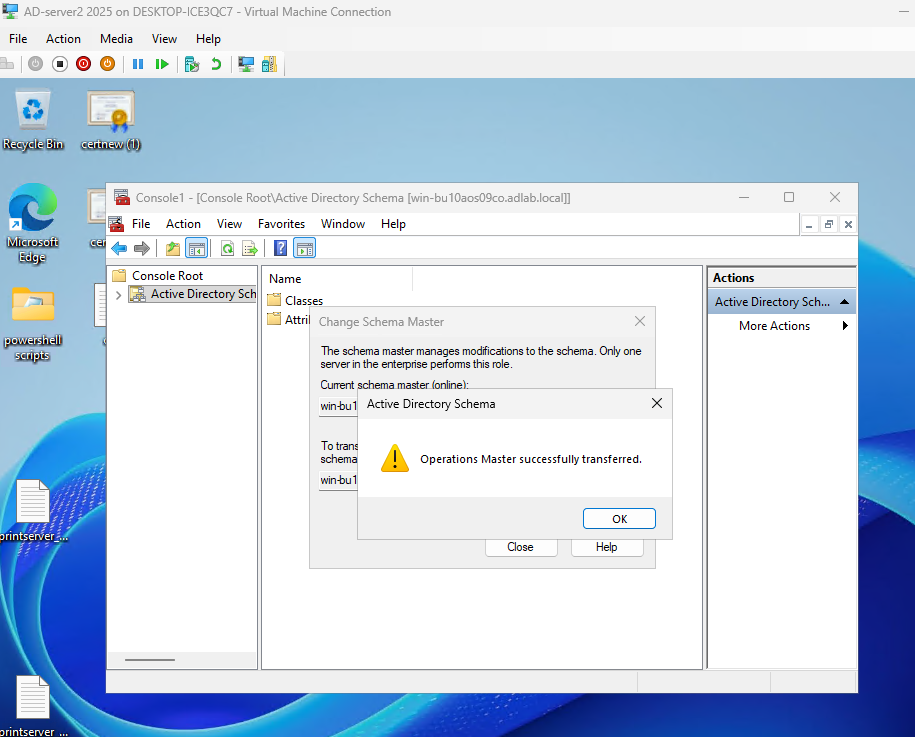

**Domain Naming Master** — in **Active Directory Domains and Trusts**, changed the directory server to `WIN-BU10AOS09CO`, then *Operations Master… › Change*:

| | |
|---|---|
| 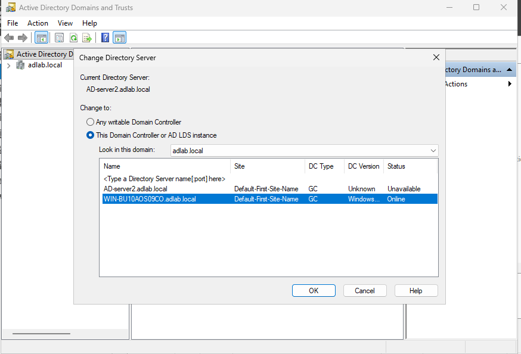 | 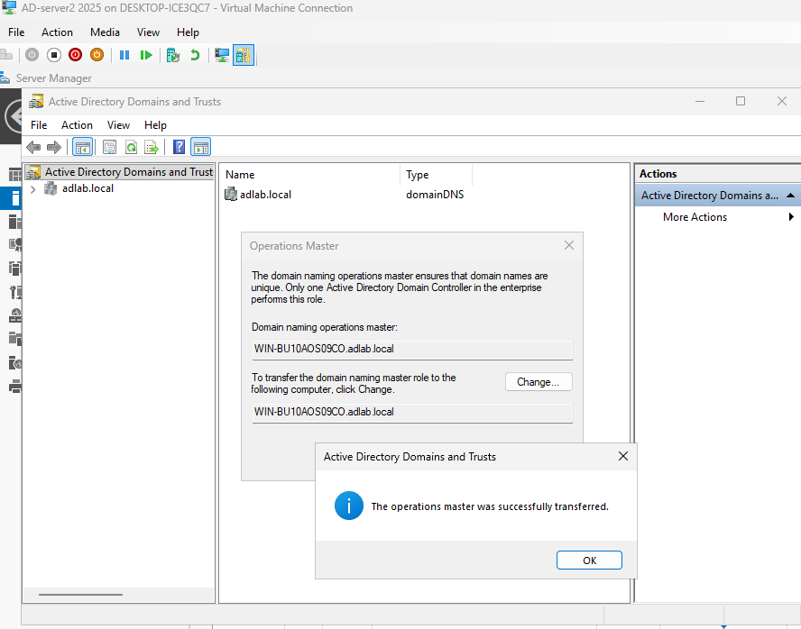 |
| *Console pointed at `WIN-BU10AOS09CO`* | *"The operations master was successfully transferred."* |

**Checkpoint:** the forest roles are back on `WIN-BU10AOS09CO`, while the domain roles are still on `AD-server2`:

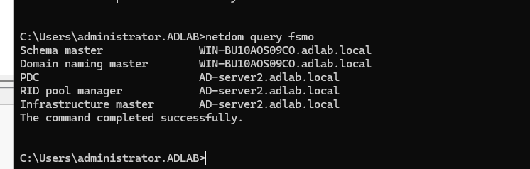

### Domain-wide roles

In **Active Directory Users and Computers**, changed the directory server to `WIN-BU10AOS09CO`, then *right-click domain › Operations Masters…* and transferred each tab:

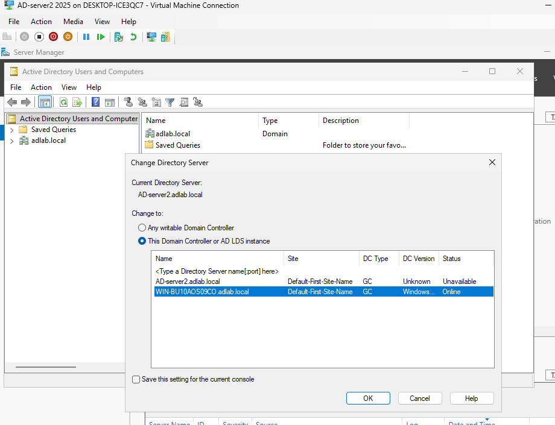

| RID | PDC | Infrastructure |
|---|---|---|
| 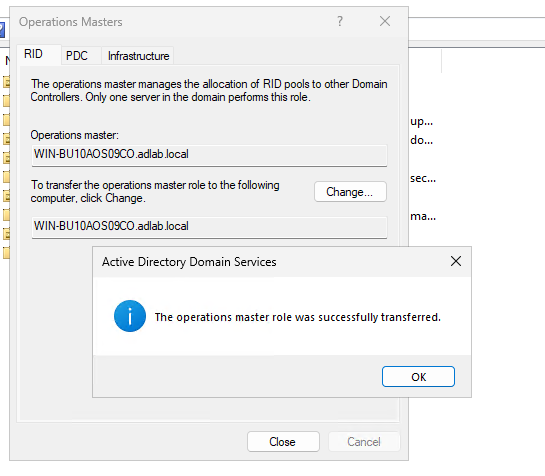 | 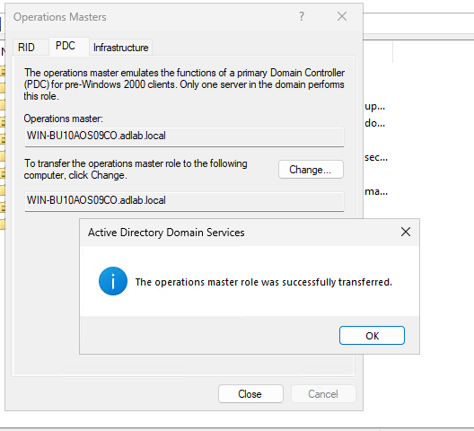 | 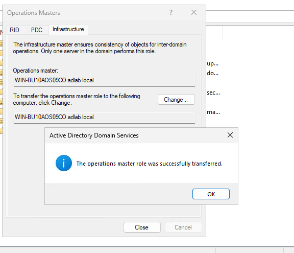 |

---

## ✅ Result

`netdom query fsmo` confirms all five roles are back on **`WIN-BU10AOS09CO.adlab.local`**:

```text
Schema master            WIN-BU10AOS09CO.adlab.local
Domain naming master     WIN-BU10AOS09CO.adlab.local
PDC                      WIN-BU10AOS09CO.adlab.local
RID pool manager         WIN-BU10AOS09CO.adlab.local
Infrastructure master    WIN-BU10AOS09CO.adlab.local
```

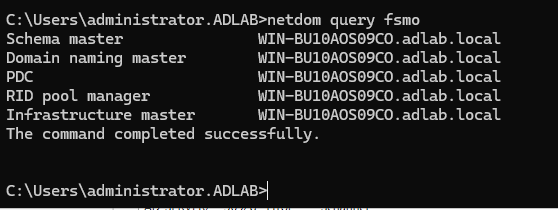

| Stage | Holder of all 5 roles | Method |
|---|---|---|
| Start | `WIN-BU10AOS09CO` | — |
| After Part 1 | `AD-SERVER2` | PowerShell, one command |
| After Part 2 | `WIN-BU10AOS09CO` | GUI: Schema, Domains and Trusts, ADUC |

---

## 🧠 Key Concepts Demonstrated

- **The five FSMO roles**, what each one does, and which are **forest-wide** (Schema, Domain Naming) vs **domain-wide** (PDC, RID, Infrastructure).
- **Which tool manages which role**: ADUC, AD Domains and Trusts, and the AD Schema snap-in (which must be registered with `regsvr32 schmmgmt.dll`).
- **GUI transfers go to the connected DC**, hence *Change Directory Server* before every transfer.
- **PowerShell** `Move-ADDirectoryServerOperationMasterRole` moves several roles at once, using numbers or names.
- **Transfer vs seize**: a transfer (used here) needs both DCs online. A **seize** (`-Force`, or `ntdsutil` *seize*) is only for a permanently failed role holder, and that DC must never come back online.
- **Verification** with `netdom query fsmo` (or `Get-ADDomain` / `Get-ADForest`) after each step.
- The **PDC Emulator** is also the domain's authoritative **time source**, so moving it changes where the other DCs sync time from.
