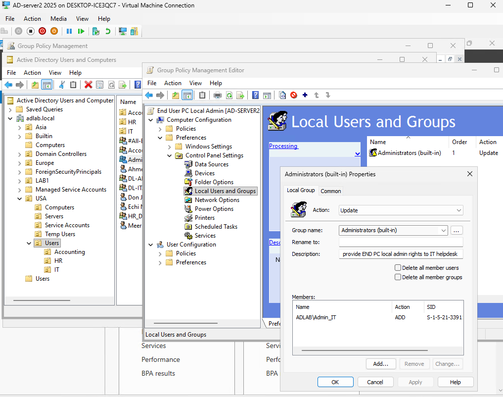
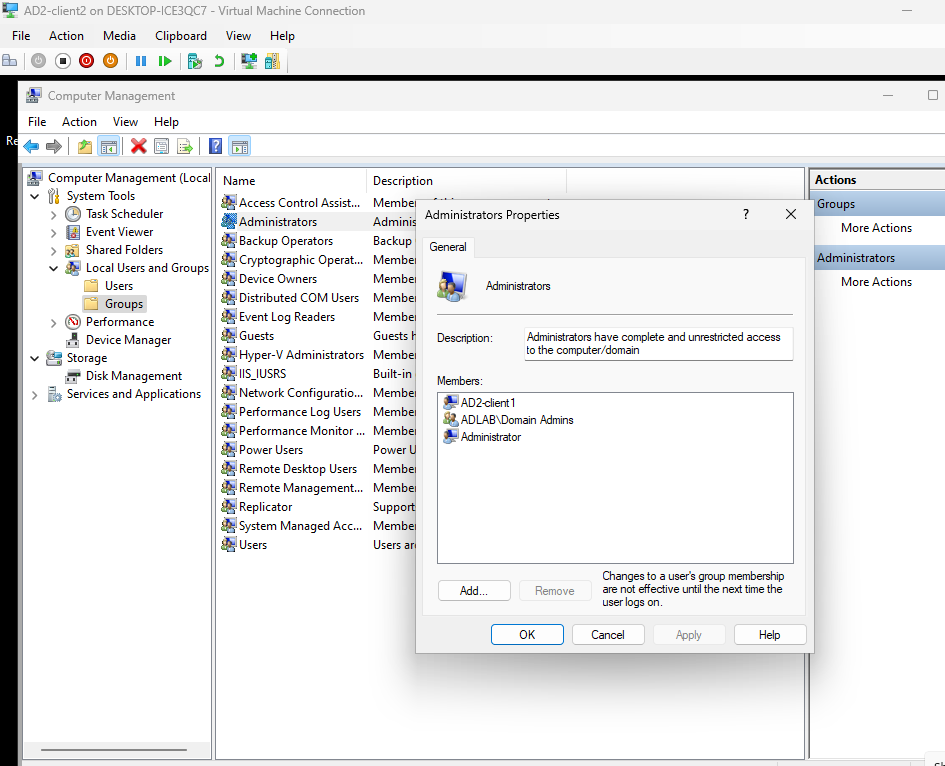
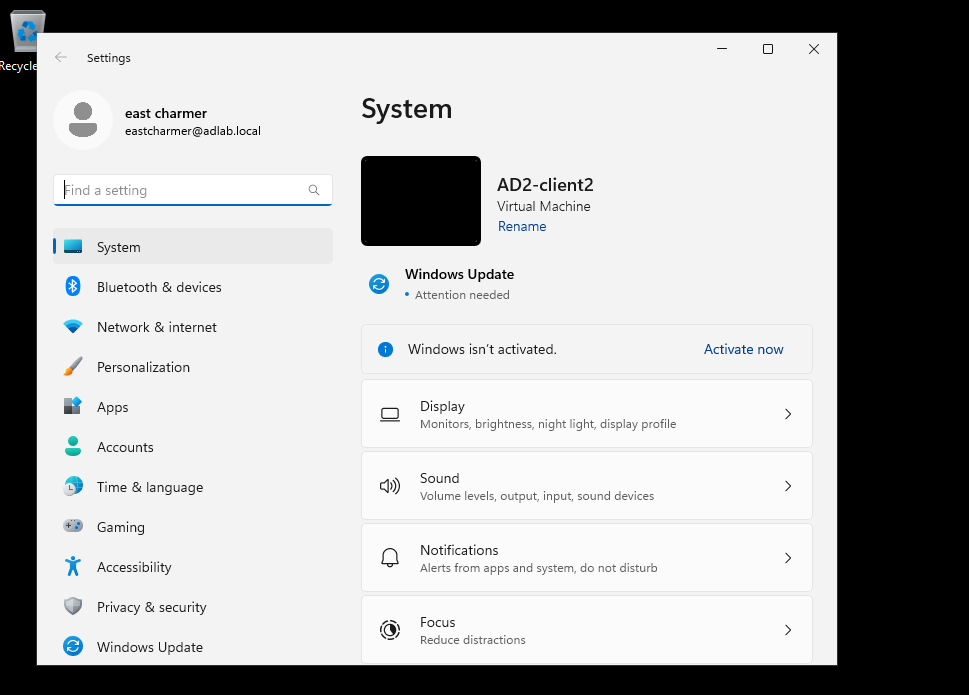
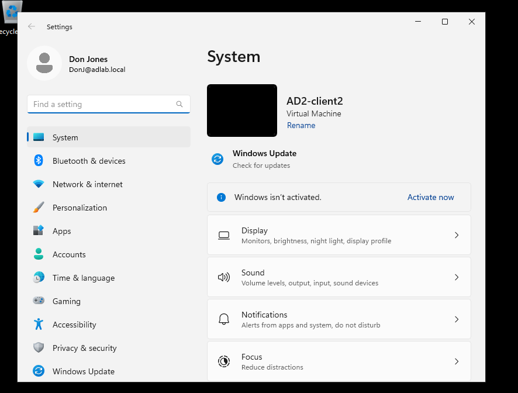
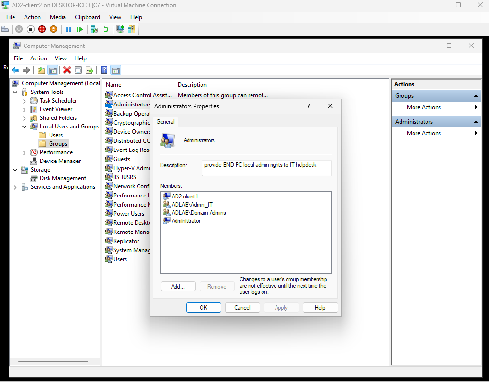
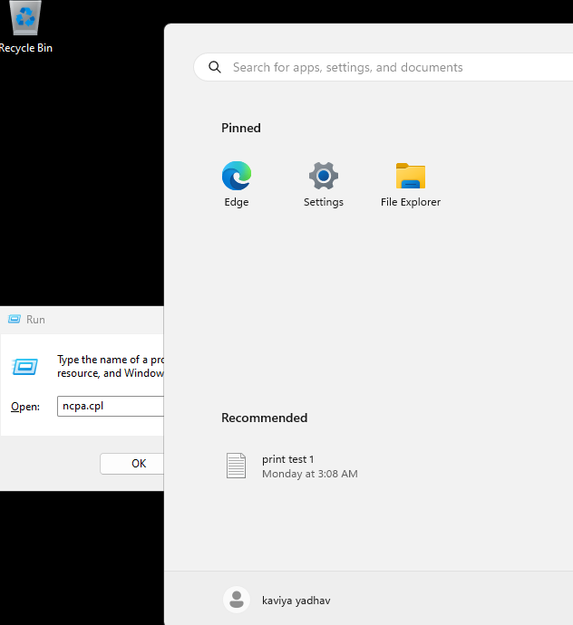
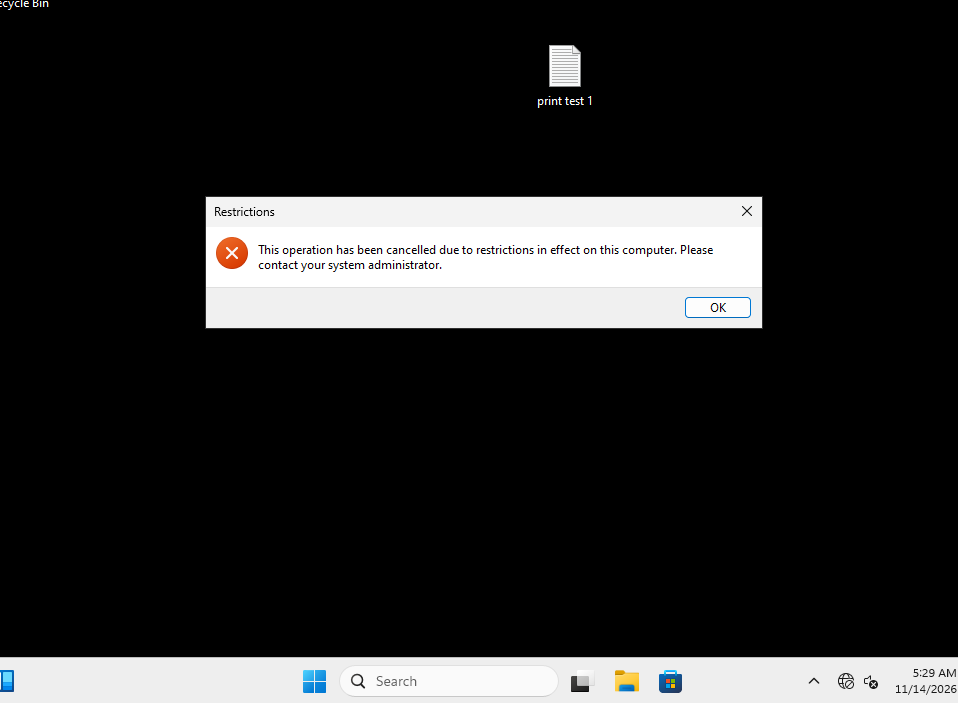

# Delegating Local Admin Rights to IT Helpdesk with Group Policy

**Lab date:** 14 November 2026  
**Management server:** `AD-server2` — Windows Server 2025  
**Test client:** `AD2-client2` — Windows 11, domain-joined  
**Domain:** `adlab.local`

[← Back to main README](../README.md)

---

## 🎯 Objective

Give the **IT helpdesk team** local administrator rights on end-user PCs **centrally through Group Policy**, so that helpdesk staff can install software and troubleshoot workstations **without being Domain Admins** and without anyone adding accounts by hand on each PC.

| Item | Value |
|---|---|
| GPO | **End User PC Local Admin** |
| Linked to | OU `adlab.local/USA` (link enabled, not enforced) |
| Security filtering | Authenticated Users |
| WMI filter | None |
| Setting | Computer Configuration › Preferences › Control Panel Settings › **Local Users and Groups** |
| Target group | **Administrators (built-in)** |
| Action | **Update** (add members without removing existing ones) |
| Member added | **`ADLAB\Admin_IT`** (IT helpdesk security group) |
| Description | *provide END PC local admin rights to IT helpdesk* |

---

## 🗺️ How it works

```text
 AD security group                GPO "End User PC Local Admin"            Every domain PC under OU=USA
 ┌────────────────┐               Computer Config › Preferences            ┌──────────────────────────────┐
 │ ADLAB\Admin_IT │──────────────►  Local Users and Groups       ────────► │ Local group: Administrators  │
 │ (IT helpdesk)  │                 Administrators (built-in)              │  ├─ Administrator            │
 └────────────────┘                 Action: Update  +ADD Admin_IT          │  ├─ ADLAB\Domain Admins      │
                                                                           │  └─ ADLAB\Admin_IT   ← added │
                                                                           └──────────────────────────────┘
```

**Why Group Policy Preferences with *Update*:**

- **Update** adds `Admin_IT` and leaves the existing members (local `Administrator`, `Domain Admins`) alone. *Delete all member users/groups* was left unchecked on purpose.
- Membership is managed through **one AD group**. When someone joins or leaves the helpdesk, you change only the `Admin_IT` group membership and touch no PCs.
- The group is referenced by its **SID**, so renaming the group doesn't break the policy.
- This follows **least privilege**: helpdesk staff get admin rights only on workstations, not on domain controllers or the domain.

---

## 🛠️ Step-by-Step Process

### Step 1 — Create the GPO and configure the local group

1. In **Group Policy Management**, created the GPO **`End User PC Local Admin`** and linked it to the **`USA`** OU.
2. Edited it: *Computer Configuration › Preferences › Control Panel Settings › Local Users and Groups › New › Local Group*.
3. Group name: **Administrators (built-in)**, Action: **Update**.
4. Description: *provide END PC local admin rights to IT helpdesk*.
5. Members → **Add** → `ADLAB\Admin_IT` with action **ADD**.



### Step 2 — Check the client before the policy applies

On `AD2-client2` → **Computer Management › Local Users and Groups › Groups › Administrators**:

- `AD2-client1` (local account)
- `ADLAB\Domain Admins`
- `Administrator`

There is no helpdesk group yet.



### Step 3 — Sign in with domain users on the client

Domain users signed in to `AD2-client2` to test the policy from the user side:

| | |
|---|---|
|  |  |
| *`eastcharmer@adlab.local` on AD2-client2* | *`DonJ@adlab.local` on AD2-client2* |

### Step 4 — Verify the policy applied

After a Group Policy refresh (`gpupdate /force` or a reboot), the local **Administrators** group on `AD2-client2` now contains:

- `AD2-client1`
- **`ADLAB\Admin_IT`** ← added by the GPO
- `ADLAB\Domain Admins`
- `Administrator`

The group description was also updated to *"provide END PC local admin rights to IT helpdesk"*, which confirms the GPP item was applied.



### Step 5 — Test a standard user (no admin rights)

Accounting user **kaviya yadhav** tried to open **Network Connections** with `ncpa.cpl` from the Run box:



Windows blocked the action with *"This operation has been cancelled due to restrictions in effect on this computer. Please contact your system administrator."* Users outside the helpdesk group stay locked down, while `Admin_IT` members have full local admin rights for support work.



---

## ✅ Results

| Test | Result |
|---|---|
| GPO created and linked to `USA` OU | ✔ |
| `ADLAB\Admin_IT` added to local Administrators on `AD2-client2` | ✔ Verified in Computer Management |
| Existing members (Administrator, Domain Admins) preserved | ✔ *Update* action |
| Domain users can sign in to the client | ✔ east charmer, Don Jones |
| Standard user blocked from restricted admin tools | ✔ Restriction message shown |

---

## 🧠 Key Concepts Demonstrated

- **Group Policy Preferences – Local Users and Groups**: the *Update*, *Create*, *Replace* and *Delete* actions, and why *Update* is the safe choice for the built-in Administrators group.
- **Role-based access**: rights are granted to an **AD security group** (`Admin_IT`), never to individual accounts.
- **Least privilege**: helpdesk gets local admin on end-user PCs instead of Domain Admin membership.
- **Computer Configuration policies** apply to the **computer objects** in the linked OU and take effect at startup or the next background refresh.
- **Verification on the client**: Computer Management › Local Users and Groups, plus `gpresult /r` and `gpupdate /force`.
- **Alternatives to know**: *Restricted Groups* (an older method that replaces membership entirely) and Windows LAPS (rotates the local Administrator password) work alongside this approach.
