# PowerShell Automation for Active Directory

**Lab date:** November 2026  
**Server:** `AD-server2` — Windows Server 2025, `10.10.10.101`  
**Domain:** `adlab.local`  
**Tools:** Windows PowerShell ISE, `ActiveDirectory` module, Active Directory Users and Computers (ADUC) for verification

[← Back to main README](../README.md)

---

## 🎯 Objective

Automate the most common user-lifecycle tasks of a Windows System Administrator with PowerShell instead of clicking through ADUC, and verify every result in the GUI:

| # | Task | Cmdlets | Script |
|---|---|---|---|
| 1 | Create a single user interactively | `Read-Host`, `New-ADUser` | [01-Create-SingleUser.ps1](../scripts/01-Create-SingleUser.ps1) |
| 2 | Bulk-create users from CSV | `Import-Csv`, `ConvertTo-SecureString`, `New-ADUser` | [02-Create-BulkUsers-FromCsv.ps1](../scripts/02-Create-BulkUsers-FromCsv.ps1) |
| 3 | Reset one password + force change at logon | `Set-ADAccountPassword`, `Set-ADUser` | [03-Reset-UserPassword.ps1](../scripts/03-Reset-UserPassword.ps1) |
| 4 | Bulk password reset + unlock from CSV | `Set-ADAccountPassword`, `Unlock-ADAccount` | [04-Reset-BulkPasswords-Unlock.ps1](../scripts/04-Reset-BulkPasswords-Unlock.ps1) |
| 5 | Move users between OUs | `Get-ADUser`, `Move-ADObject` | [05-Move-UsersToOU.ps1](../scripts/05-Move-UsersToOU.ps1) |
| 6 | Export users of an OU to CSV | `Get-ADUser -SearchBase`, `Export-Csv` | [06-Export-OUUsers.ps1](../scripts/06-Export-OUUsers.ps1) |
| 7 | Add a user to a group | `Add-ADGroupMember` | [07-Add-UserToGroup.ps1](../scripts/07-Add-UserToGroup.ps1) |
| 8 | Remove a user from a group | `Remove-ADGroupMember` | [08-Remove-UserFromGroup.ps1](../scripts/08-Remove-UserFromGroup.ps1) |
| 9 | Disable inactive accounts | `Get-ADUser -Filter {LastLogonDate -lt …}`, `Disable-ADAccount` | [09-Disable-InactiveUsers.ps1](../scripts/09-Disable-InactiveUsers.ps1) |
| 10 | Export an all-users report | `Get-ADUser -Filter *`, `Export-Csv` | [10-Export-AllUsersReport.ps1](../scripts/10-Export-AllUsersReport.ps1) |

**Naming convention used by the scripts:** `sAMAccountName = FirstName + first letter of LastName` (e.g. *Don Jones → DonJ*), `UPN = sAMAccountName@adlab.local`.

---

## 🛠️ Step-by-Step Process

### 1 — Create a single user interactively

The script prompts for first name, last name and password (`Read-Host -AsSecureString`, so the password is never shown or stored in plain text), builds the logon name and UPN, and creates the account in **`OU=Temp Users,OU=USA,DC=adlab,DC=local`**.

```powershell
$firstName         = Read-Host "Enter First Name"
$lastName          = Read-Host "Enter Last Name"
$samAccountName    = $firstName + $lastName.Substring(0,1)
$userPrincipalName = $samAccountName + "@adlab.local"
$ouPath            = "OU=Temp Users,OU=USA,DC=adlab,DC=local"
$password          = Read-Host -AsSecureString "Enter Password"

New-ADUser -Name "$firstName $lastName" -GivenName $firstName -Surname $lastName `
    -SamAccountName $samAccountName -UserPrincipalName $userPrincipalName `
    -Path $ouPath -AccountPassword $password -Enabled $true
```

| | |
|---|---|
| 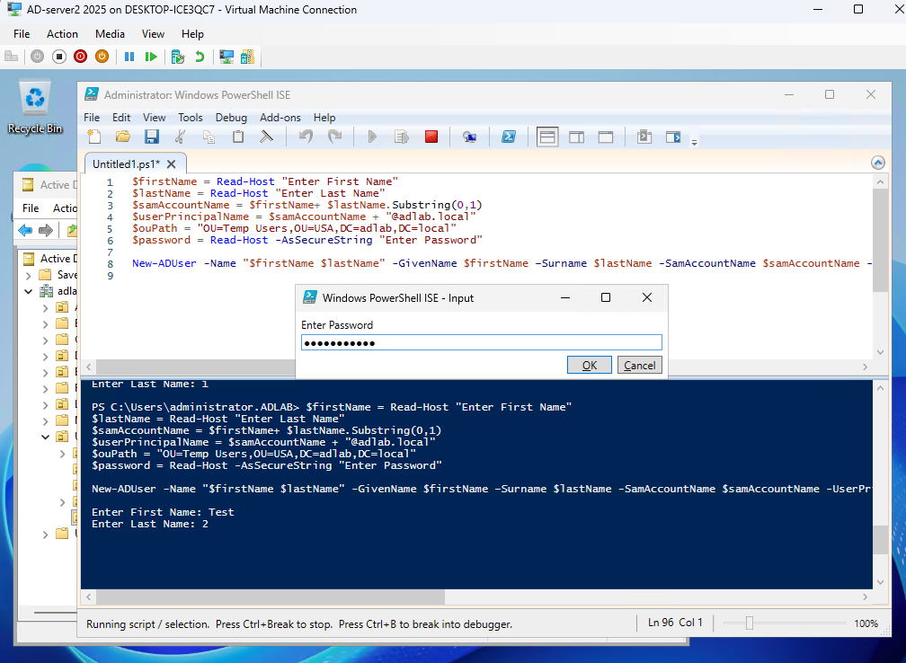 | 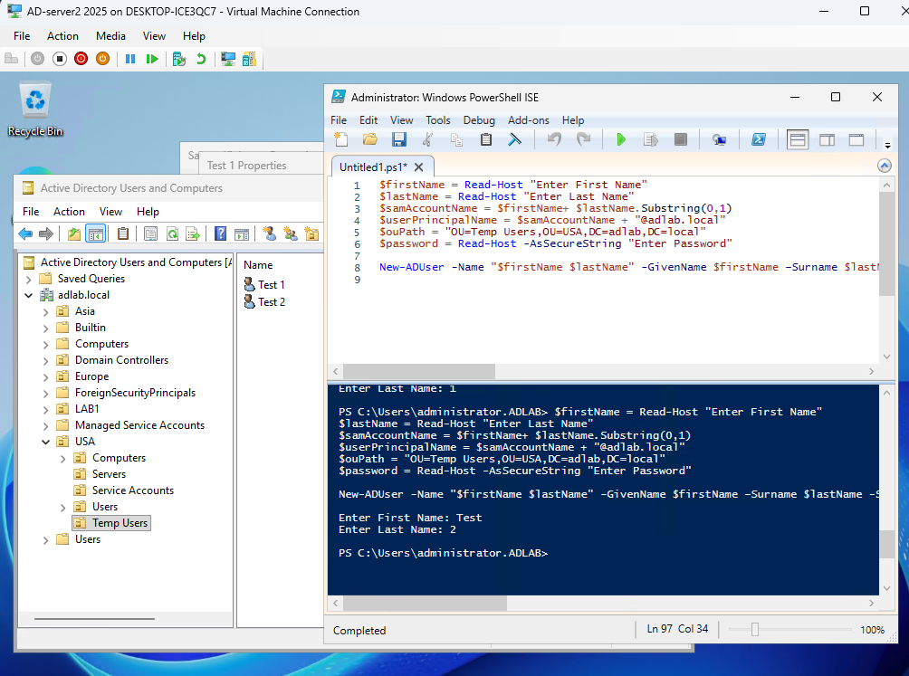 |
| *Secure password prompt in PowerShell ISE* | *`Test 1` and `Test 2` created in `USA › Temp Users`* |

### 2 — Bulk-create users from a CSV file

`Bulk_Users.csv` holds `FirstName, LastName, OU, Password`. `Import-Csv` pipes every row into `New-ADUser`; the target OU comes from the CSV, so one file can place users in different OUs. `(Get-ADDomain).DistinguishedName` was used first to confirm the domain DN (`DC=adlab,DC=local`).

```powershell
Import-Csv -Path "...\Bulk_Users.csv" | ForEach-Object {
    $samAccountName    = $_.FirstName + $_.LastName.Substring(0,1)
    $userPrincipalName = $samAccountName + "@adlab.local"
    $password          = ConvertTo-SecureString $_.Password -AsPlainText -Force
    New-ADUser -Name "$($_.FirstName) $($_.LastName)" ... -Path $_.OU -AccountPassword $password -Enabled $true
}
```

**Result:** Meer Ali, Don Jones, Tom Jerry, Test User1, Ahmed N, Talha N and Echi N were created in `Temp Users`.

**Error handled — duplicate UPN:** `Test User1` and `Test User2` both produce the logon name **`TestU`**, so AD rejected the second account with *"The operation failed because UPN value provided for addition/modification is not unique forest-wide"*. This shows why a naming convention needs a uniqueness check (e.g. test with `Get-ADUser -Filter "SamAccountName -eq '$sam'"` and append a number).

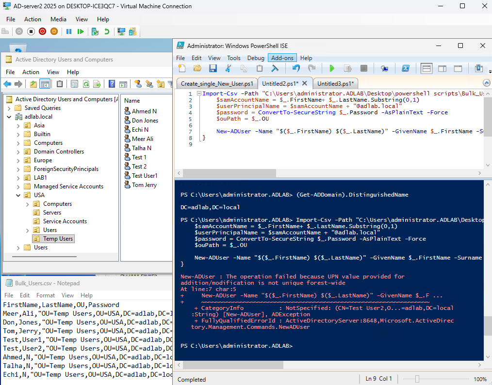

### 3 — Reset a single password and force change at next logon

```powershell
$user     = Read-Host "Enter the username (sAMAccountName)"
$password = Read-Host -AsSecureString "Enter the new password"

Set-ADAccountPassword -Identity $user -NewPassword $password
Set-ADUser -Identity $user -ChangePasswordAtLogon $true
Write-Host "Password for $user has been reset successfully."
```

Tested on `testu` — the classic help-desk ticket: reset the password and make the user choose a new one at next sign-in.

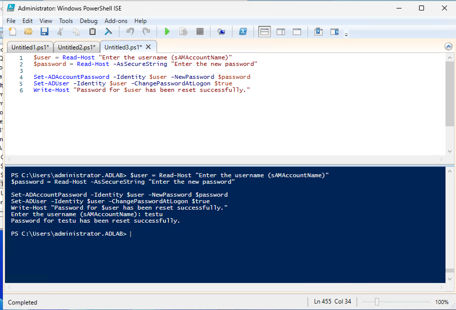

### 4 — Bulk password reset and account unlock

`bulk_user_reset_password.csv` (`SamAccountName, NewPassword`) drives a reset **and** `Unlock-ADAccount` for each user — useful after a lockout wave or when onboarding a batch of users.

**Result:** AhmedN, DonJ, echin, MeerA and TalhaN reset successfully.

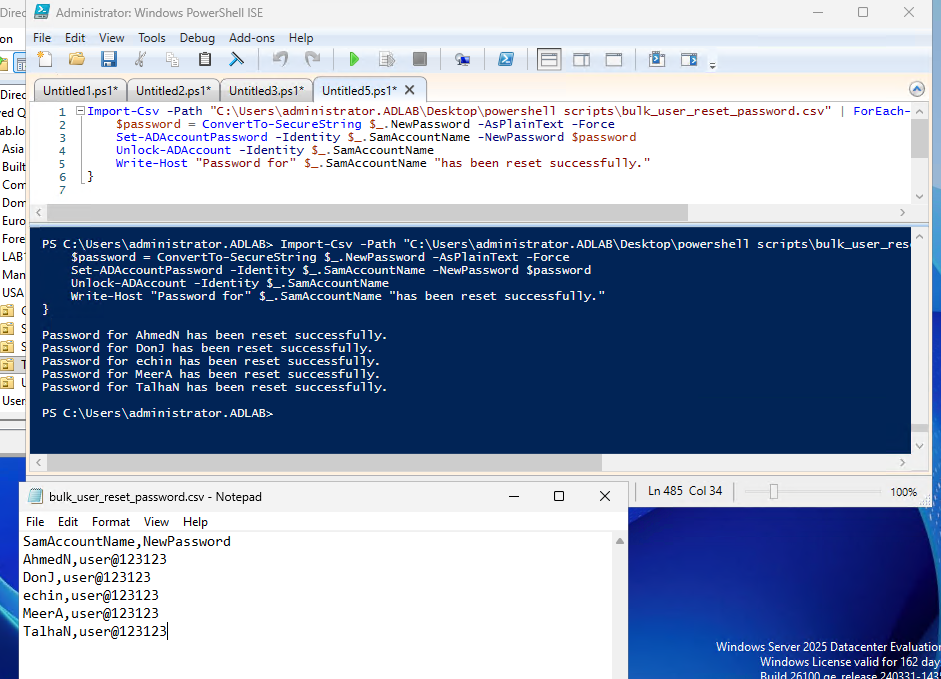

### 5 — Move users to another OU

Four users were moved from `Temp Users` into their permanent OU, `OU=Users,OU=USA,DC=adlab,DC=local`. `Get-ADUser` looks up each account's **DistinguishedName**, which `Move-ADObject` needs.

```powershell
$users    = "AhmedN", "DonJ", "MeerA", "echin"
$targetOU = "OU=Users,OU=USA,DC=adlab,DC=local"

foreach ($user in $users) {
    $userDN = (Get-ADUser -Identity $user).DistinguishedName
    Move-ADObject -Identity $userDN -TargetPath $targetOU
    Write-Host "$user has been moved to $targetOU."
}
```

| | |
|---|---|
| 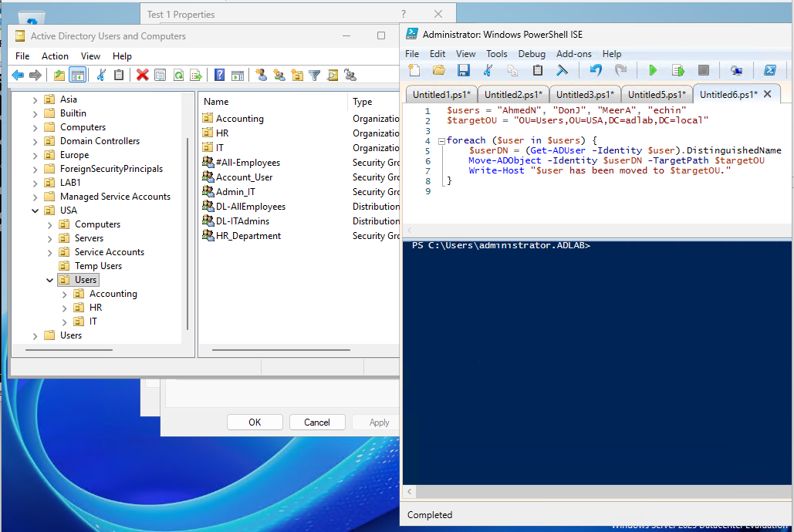 | 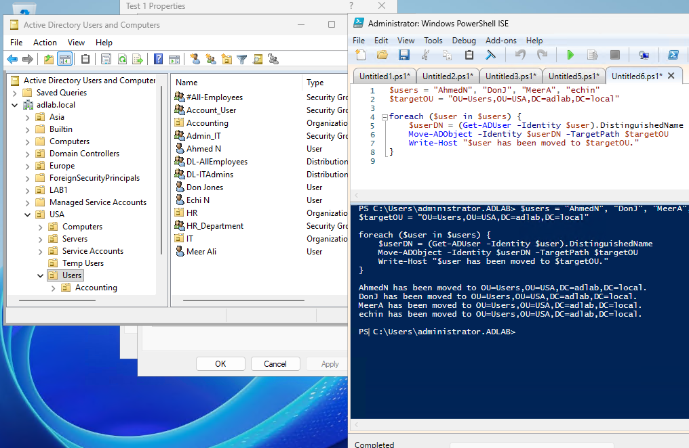 |
| *Before — `USA › Users` contains only sub-OUs and groups* | *After — Ahmed N, Don Jones, Echi N and Meer Ali now in `USA › Users`* |

The `USA › Users` OU also shows the group design used in the lab: security groups (`#All-Employees`, `Account_User`, `Admin_IT`, `HR_Department`) and distribution groups (`DL-AllEmployees`, `DL-ITAdmins`).

### 6 — Export the users of one OU to CSV

`-SearchBase` limits the query to `Temp Users`; the selected attributes are written to `ADUsersExport.csv`.

```powershell
Get-ADUser -Filter * -SearchBase $ouPath -Properties Name, givenName, sAMAccountName, userPrincipalName, userAccountControl, cn, LastLogonDate, objectSid |
    Select-Object Name, givenName, sAMAccountName, userPrincipalName, userAccountControl, cn, LastLogonDate, objectSid |
    Export-Csv -Path $outputPath -NoTypeInformation
```

The export lists the four users still in `Temp Users` (Tom Jerry, Test User1, Talha N, Test 1). `userAccountControl = 512` means **normal, enabled account**.

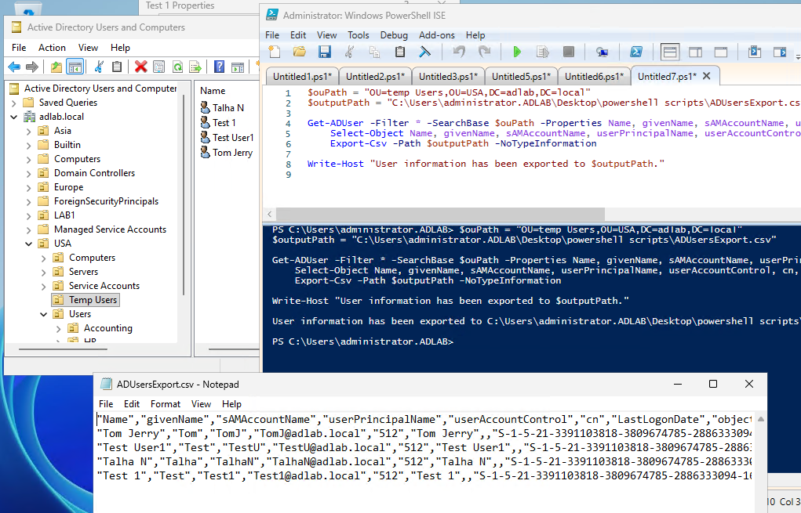

### 7 — Add a user to a security group

```powershell
Add-ADGroupMember -Identity $groupName -Members $userName
```

`donj` was added to **`Account_User`** — the group's *Members* tab now shows Don Jones next to the existing member kavya yadhav.

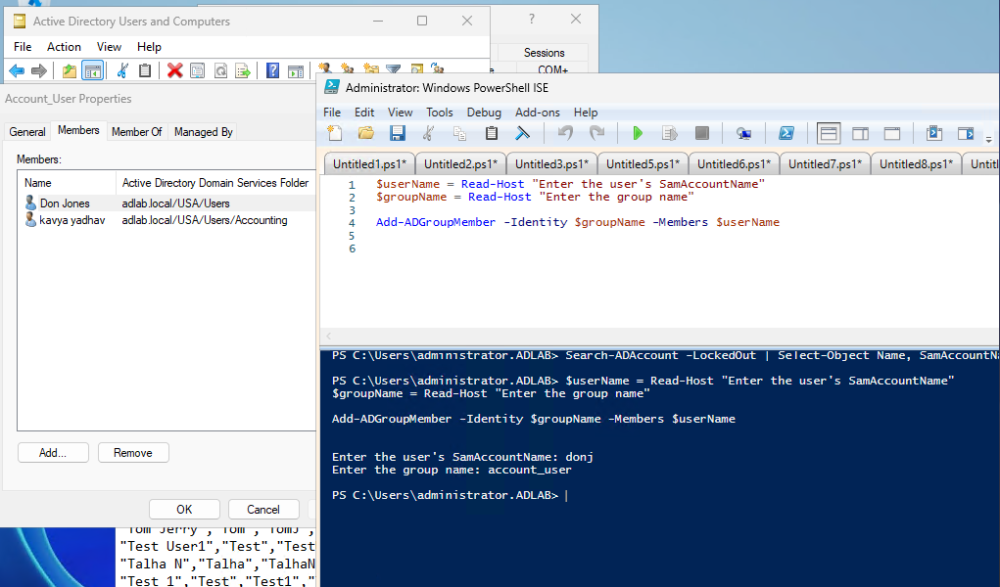

### 8 — Remove a user from a security group

```powershell
Remove-ADGroupMember -Identity $groupName -Members $userName -Confirm:$false
```

`-Confirm:$false` suppresses the prompt so the script can run unattended. Don Jones is removed; only kavya yadhav remains in `Account_User`.

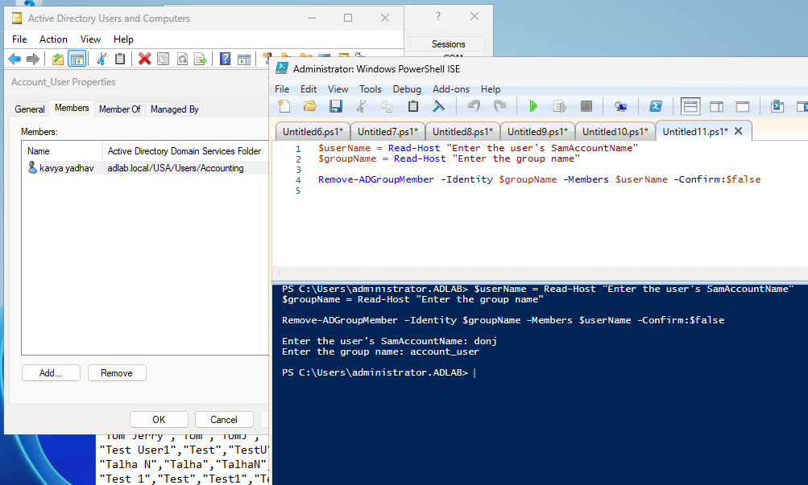

### 9 — Disable inactive user accounts

Finds every user whose `LastLogonDate` is older than the threshold and disables it — a standard security-hygiene task. A **5-day** threshold was used so the lab would return results.

```powershell
$daysInactive = 5
$time         = (Get-Date).AddDays(-$daysInactive)

Get-ADUser -Filter {LastLogonDate -lt $time} -Property LastLogonDate | ForEach-Object {
    Disable-ADAccount -Identity $_.SamAccountName
    Write-Host "Disabled user account:" $_.SamAccountName
}
```

The disabled accounts were verified with an ADUC **Saved Query** named *disabled users*.

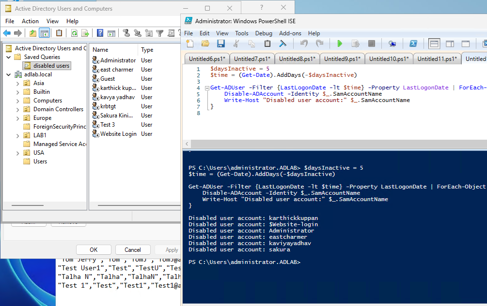

### 10 — Export a report of all domain users

```powershell
Get-ADUser -Filter * -Property DisplayName, SamAccountName, UserPrincipalName, EmailAddress, LastLogonDate |
    Select-Object DisplayName, SamAccountName, UserPrincipalName, EmailAddress, LastLogonDate |
    Export-Csv -Path "...\AllADUsers.csv" -NoTypeInformation
```

Produces `AllADUsers.csv` — a domain-wide inventory with last-logon dates, the kind of report requested for audits and licence reviews.

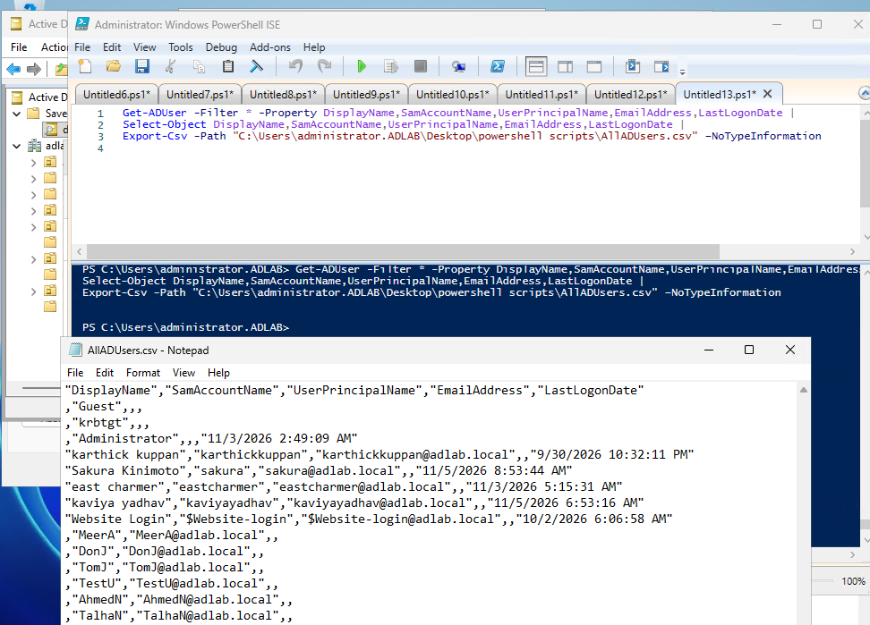

---

## ✅ Results

| Task | Result |
|---|---|
| Single user creation | ✔ `Test 1`, `Test 2` created in `Temp Users` |
| Bulk creation from CSV | ✔ 7 users created; duplicate UPN detected and reported by AD |
| Single password reset + change at logon | ✔ `testu` |
| Bulk reset + unlock | ✔ 5 users |
| Move users between OUs | ✔ 4 users moved to `USA › Users` |
| Export OU users | ✔ `ADUsersExport.csv` |
| Add / remove group member | ✔ `donj` added to and removed from `Account_User` |
| Disable inactive accounts | ✔ Accounts disabled and verified with a saved query |
| All-users report | ✔ `AllADUsers.csv` |

---

## 🧠 Key Concepts & Lessons Learned

- **Secure password handling** — `Read-Host -AsSecureString` for interactive input; `ConvertTo-SecureString -AsPlainText -Force` only for CSV-driven lab automation.
- **Distinguished Names** — building OU paths (`OU=…,DC=adlab,DC=local`) and retrieving an object's DN for `Move-ADObject`.
- **Pipeline automation** — `Import-Csv | ForEach-Object` for bulk operations; `Get-ADUser | Select-Object | Export-Csv` for reporting.
- **Naming conventions must guarantee uniqueness** — `FirstName + LastInitial` collided for *Test User1 / Test User2*; AD enforces forest-wide unique UPNs.
- **`LastLogonDate` behaviour** — it is based on the replicated `lastLogonTimestamp`, which can lag by up to ~14 days, and accounts that have **never** logged on have an empty value, so they are not matched by `-lt`. Real inactivity scripts use 30–90 day thresholds.
- **Exclude privileged and service accounts from bulk disables** — the inactivity run also matched the built-in `Administrator` and the service-style account `$Website-login`. In production the filter should exclude these (e.g. `-SearchBase` limited to user OUs, or filtering out `adminCount -eq 1`), and the script should first run with `-WhatIf`.
- **Attributes not set at creation stay empty** — bulk-created users have no `DisplayName`/`EmailAddress` in the report because `New-ADUser` was not given `-DisplayName` / `-EmailAddress`.
- **Verify in the GUI** — every scripted change was confirmed in ADUC (OU contents, group *Members* tab, saved queries).
