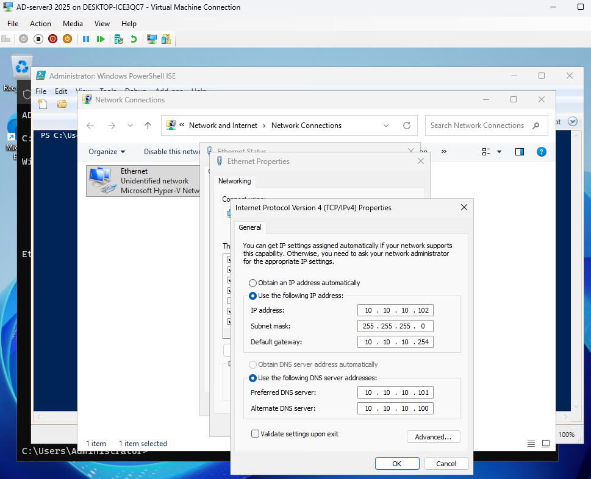
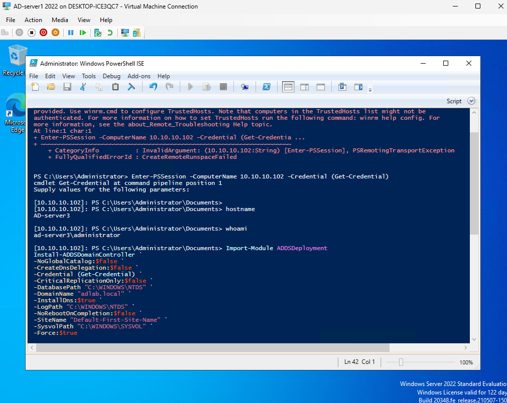
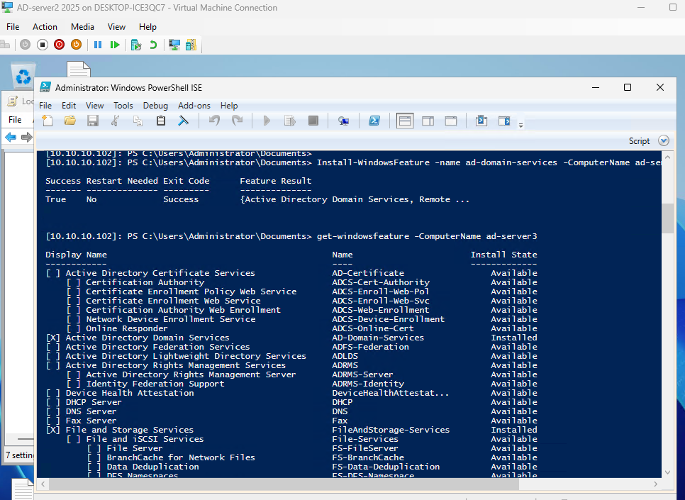
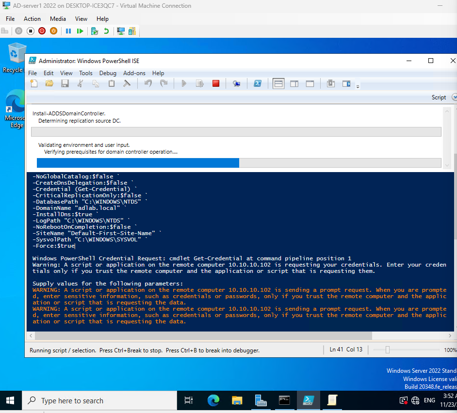
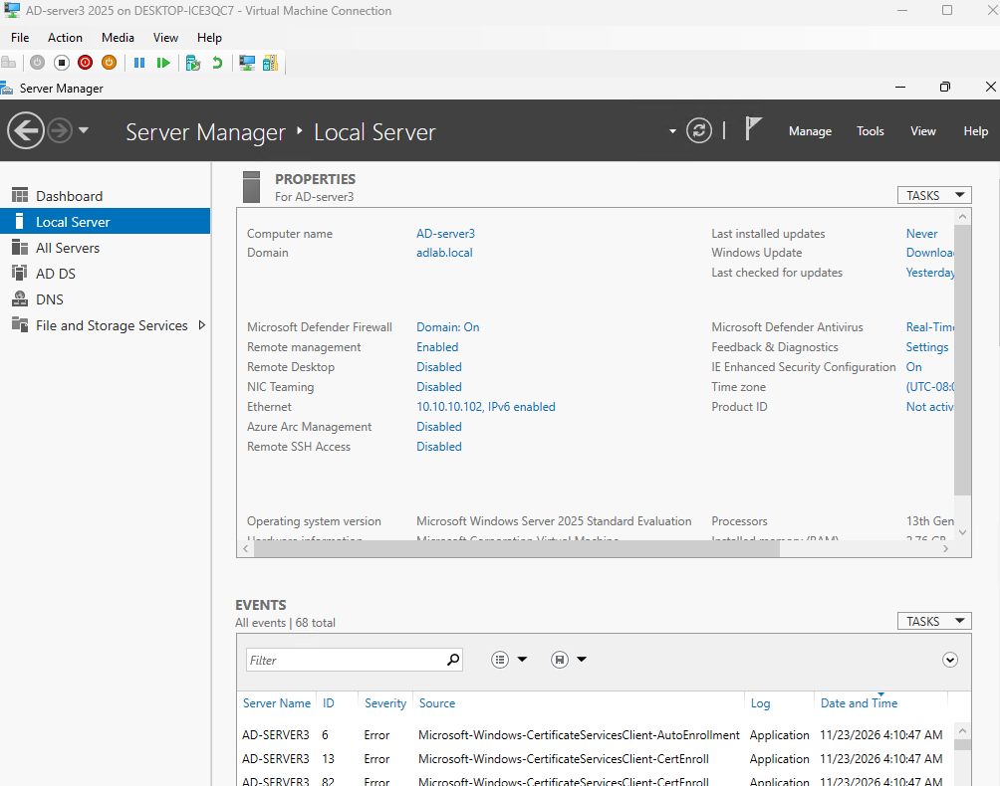

# Promoting a Third Domain Controller Remotely with PowerShell

**Lab date:** 23 November 2026  
**Domain:** `adlab.local`  
**New server:** `AD-server3`, Windows Server 2025 Standard, `10.10.10.102`  
**Managed from:** `AD-server1` (`WIN-BU10AOS09CO`), Windows Server 2022

[← Back to main README](../README.md)

---

## 🎯 Objective

Add a **third domain controller** to `adlab.local` without working on the new server's console. Everything was done **remotely from AD-server1** over **PowerShell Remoting (WinRM)**:

1. Give the new server a static IP and point its DNS at the existing DCs.
2. Open a remote PowerShell session to the new server.
3. Install the AD DS role remotely.
4. Promote it to a replica DC with an `Install-ADDSDomainController` script **taken from the Server Manager wizard** ("View script"), instead of clicking through the wizard.

```text
 AD-server1 (WIN-BU10AOS09CO)                         AD-server3 (new, 10.10.10.102)
 ┌───────────────────────────┐   Enter-PSSession     ┌──────────────────────────────┐
 │ PowerShell ISE            │ ───── WinRM ────────► │ Install-WindowsFeature       │
 │  TrustedHosts += .102     │   (TCP 5985)          │   AD-Domain-Services         │
 │  Get-Credential           │                       │ Install-ADDSDomainController │
 └───────────────────────────┘                       │   -DomainName adlab.local    │
                                                     │   -InstallDns -GC            │
         replication source ◄──── AD replication ────┤ → reboot → DC + DNS + GC     │
  AD-server2 (.101) / AD-server1 (.100)              └──────────────────────────────┘
```

---

## 🛠️ Step-by-Step Process

### Step 1 — Network configuration on the new server

`AD-server3` was given a static IPv4 configuration on the lab network:

| Setting | Value |
|---|---|
| IP address | `10.10.10.102` |
| Subnet mask | `255.255.255.0` |
| Default gateway | `10.10.10.254` (pfSense) |
| Preferred DNS | `10.10.10.101` (AD-server2) |
| Alternate DNS | `10.10.10.100` (AD-server1) |

Pointing DNS at the existing DCs is essential. The new server finds the domain and its DCs through **SRV records in AD-integrated DNS**, and a public DNS server cannot resolve `adlab.local`.



### Step 2 — Open a remote PowerShell session (and fix TrustedHosts)

From **AD-server1**, the first attempt failed:

```powershell
Enter-PSSession -ComputerName 10.10.10.102 -Credential (Get-Credential)
```

> *Enter-PSSession : … Use winrm.cmd to configure TrustedHosts … (PSRemotingTransportException / CreateRemoteRunspaceFailed)*

**Why:** `AD-server3` was **not yet a domain member**, and it was addressed **by IP**. In that case WinRM cannot use Kerberos to authenticate the remote computer, so the target must be listed in the client's **TrustedHosts** (or HTTPS must be used).

**Fix:** add the new server to TrustedHosts on AD-server1, then reconnect:

```powershell
Set-Item WSMan:\localhost\Client\TrustedHosts -Value "10.10.10.102" -Concatenate -Force
Enter-PSSession -ComputerName 10.10.10.102 -Credential (Get-Credential)
```

The session opened. The prompt changed to `[10.10.10.102]: PS …>`, `hostname` returned **AD-server3**, and `whoami` returned **ad-server3\administrator** (the local admin, since it was not yet in the domain).



### Step 3 — Install the AD DS role remotely

```powershell
Install-WindowsFeature -Name AD-Domain-Services -ComputerName ad-server3
Get-WindowsFeature -ComputerName ad-server3
```

Result: **Success = True, Restart Needed = No**. `Get-WindowsFeature` shows **[X] Active Directory Domain Services — Installed**.



### Step 4 — Promote to a replica DC with the wizard-generated script

On the new server, the **Active Directory Domain Services Configuration Wizard** was filled in (*Add a domain controller to an existing domain*) up to the **Review Options** page. **View script** gave the exact PowerShell equivalent. That script was then run from the remote session on AD-server1:

```powershell
Import-Module ADDSDeployment
Install-ADDSDomainController `
    -NoGlobalCatalog:$false `
    -CreateDnsDelegation:$false `
    -Credential (Get-Credential) `
    -CriticalReplicationOnly:$false `
    -DatabasePath "C:\WINDOWS\NTDS" `
    -DomainName "adlab.local" `
    -InstallDns:$true `
    -LogPath "C:\WINDOWS\NTDS" `
    -NoRebootOnCompletion:$false `
    -SiteName "Default-First-Site-Name" `
    -SysvolPath "C:\WINDOWS\SYSVOL" `
    -Force:$true
```

| Parameter | Meaning |
|---|---|
| `-NoGlobalCatalog:$false` | The new DC **is** a Global Catalog |
| `-InstallDns:$true` | Installs DNS and hosts the AD-integrated zones |
| `-CreateDnsDelegation:$false` | No delegation needed (no parent zone for `adlab.local`) |
| `-Credential (Get-Credential)` | A domain admin account (`ADLAB\…`) authorises adding a DC |
| `-CriticalReplicationOnly:$false` | Full replication before the first reboot |
| `-DatabasePath` / `-LogPath` / `-SysvolPath` | Locations of `ntds.dit`, its logs and SYSVOL |
| `-SiteName` | Places the DC in `Default-First-Site-Name` |
| `-NoRebootOnCompletion:$false` | Reboots automatically when finished |
| `-Force:$true` | Skips the confirmation prompts |

The cmdlet also prompts for the **DSRM (Safe Mode Administrator) password**. During the run, the progress bar shows **"Determining replication source DC"** and **"Verifying prerequisites for domain controller operation"**. PowerShell warns that the *remote computer is requesting credentials*, which is expected because `Get-Credential` runs inside the remote session.



`Install-ADDSDomainController` **joins the server to the domain and promotes it in one step**, so no separate domain join was needed.

### Step 5 — Verify

After the automatic reboot, **Server Manager on AD-server3** shows:

- Domain: **adlab.local**
- Roles: **AD DS** and **DNS** in the navigation pane
- Ethernet: **10.10.10.102**
- OS: Windows Server 2025 Standard Evaluation



**Observation:** the Events pane shows **CertificateServicesClient-AutoEnrollment / CertEnroll** errors (IDs 6, 13, 82). The new DC tries to **auto-enrol a Domain Controller certificate** from the Enterprise CA on AD-server2 straight after promotion. These errors usually clear once replication and Group Policy have settled, and can be checked later with `certutil -pulse` and `gpupdate /force`.

**Recommended checks** for a new DC:

```cmd
repadmin /replsummary
dcdiag /s:AD-server3
netdom query dc
```

---

## ✅ Result

| Item | Status |
|---|---|
| Static IP and DNS pointing at existing DCs | ✔ |
| Remote session over WinRM (TrustedHosts fixed) | ✔ |
| AD DS role installed remotely | ✔ |
| Promoted with the wizard-generated `Install-ADDSDomainController` script | ✔ |
| AD-server3 is a DC in `adlab.local` with DNS and Global Catalog | ✔ |

The domain now has **three domain controllers**: AD-server1 (`.100`), AD-server2 (`.101`) and AD-server3 (`.102`).

---

## 🧠 Key Concepts Demonstrated

- **PowerShell Remoting / WinRM**: `Enter-PSSession`, Kerberos vs NTLM, why a **workgroup machine addressed by IP** needs **TrustedHosts** (or HTTPS on port 5986).
- **Remote server management**: `Install-WindowsFeature` / `Get-WindowsFeature -ComputerName`.
- **Infrastructure as code**: turning a GUI wizard into a **repeatable script** with *View script*.
- **`Install-ADDSDomainController` parameters**: GC, DNS, delegation, paths, site, DSRM password.
- **DNS client settings for DCs**: point at existing AD DNS servers, never at public resolvers.
- **Post-promotion behaviour**: automatic reboot, joining and promoting in one step, Domain Controller certificate auto-enrolment with an Enterprise CA.
